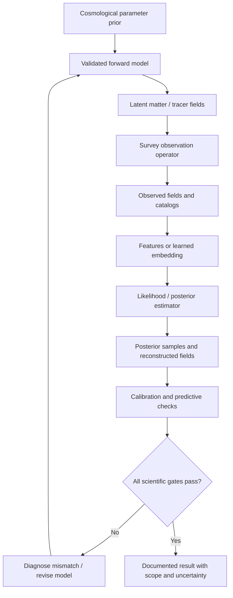
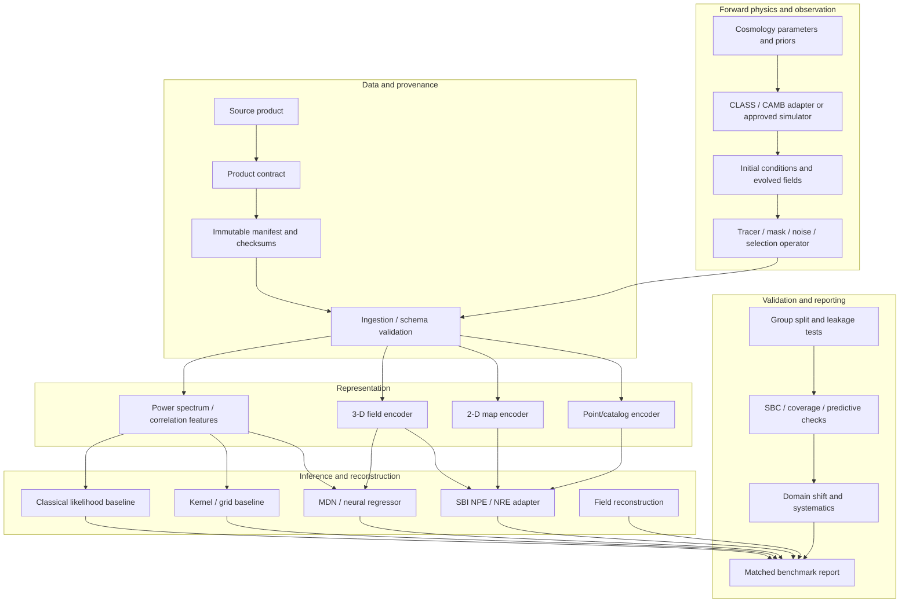
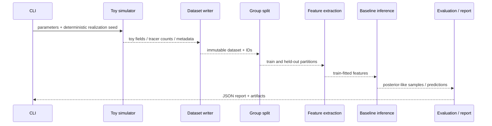
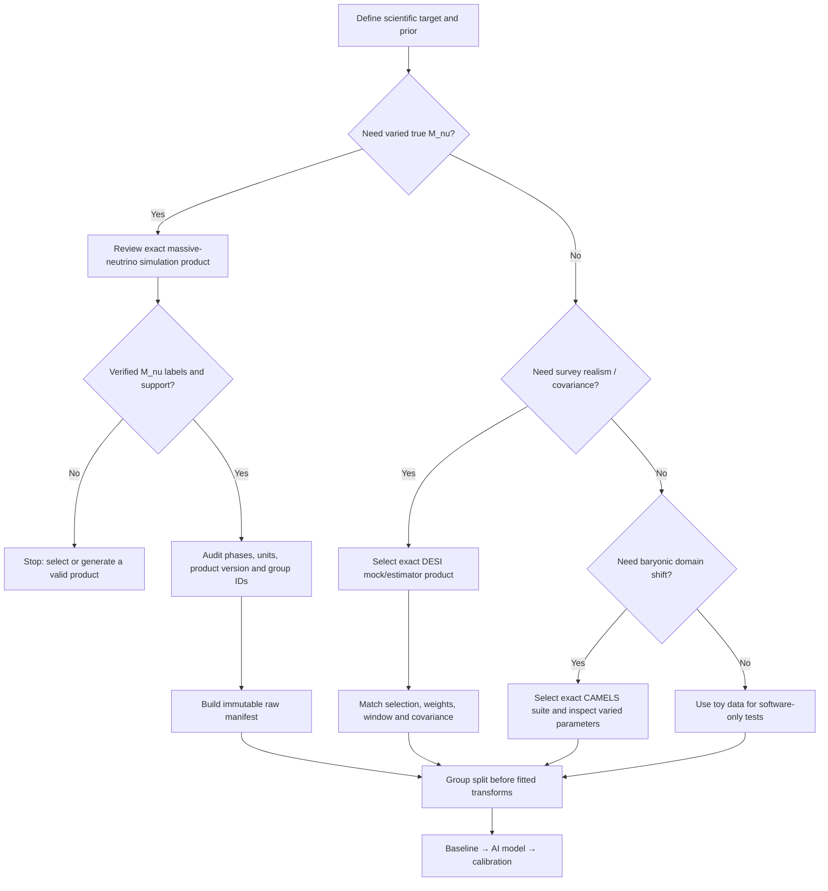
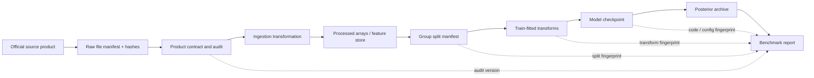
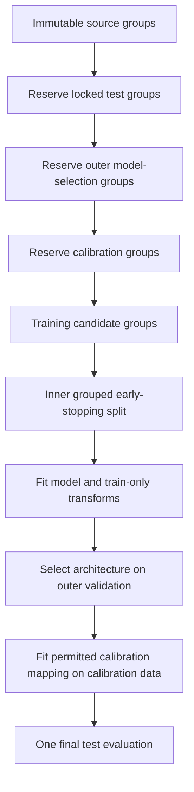
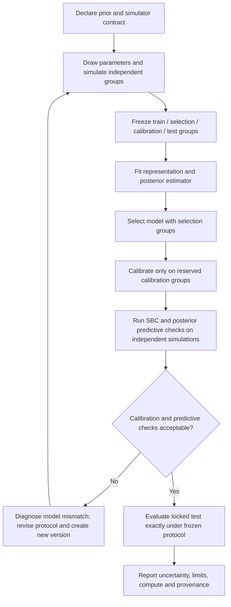
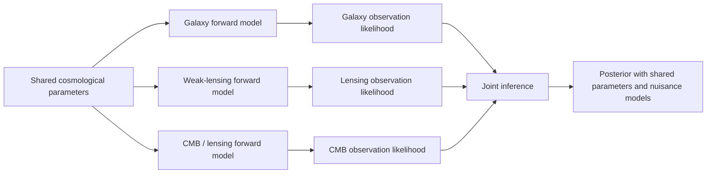

# VField — AI for Reconstructing the Universe and Measuring Neutrino Mass


> **Research software scaffold for cosmological field-level inference, neural simulation-based inference, multimodal observations, and dataset-quality engineering.**
>
> **Scientific status:** the repository currently includes synthetic demonstration data, approximate analysis components, validation utilities, and optional interfaces to external cosmology solvers. It does **not** yet establish a physical constraint on the sum of neutrino masses, and its default toy simulator is not a calibrated massive-neutrino simulation.

<p align="center">
  <strong>Simulate → Observe → Reconstruct → Infer → Calibrate → Stress-test</strong>
</p>

VField is an open research-software project investigating how machine learning can help extract cosmological information from spatial fields without sacrificing statistical calibration, physical interpretability, or reproducibility. The software is organized around a simple research principle: **a more complicated neural model is useful only if a controlled experiment shows that it extracts additional information and remains reliable under independent validation.**


---

## Table of contents

- [1. Project in one minute](#1-project-in-one-minute)
- [2. Scientific motivation](#2-scientific-motivation)
- [3. Research questions and falsifiable hypotheses](#3-research-questions-and-falsifiable-hypotheses)
- [4. Scope, non-goals, and maturity levels](#4-scope-non-goals-and-maturity-levels)
- [5. Scientific background and notation](#5-scientific-background-and-notation)
- [6. End-to-end architecture](#6-end-to-end-architecture)
- [7. Repository map](#7-repository-map)
- [8. Installation and environment setup](#8-installation-and-environment-setup)
- [9. First run: end-to-end synthetic demo](#9-first-run-end-to-end-synthetic-demo)
- [10. Command-line reference](#10-command-line-reference)
- [11. Dataset strategy: select the right source for the task](#11-dataset-strategy-select-the-right-source-for-the-task)
- [12. Dataset contract and provenance model](#12-dataset-contract-and-provenance-model)
- [13. Ingestion, transformations, and data quality](#13-ingestion-transformations-and-data-quality)
- [14. Splits, leakage prevention, and evaluation design](#14-splits-leakage-prevention-and-evaluation-design)
- [15. Baselines before deep learning](#15-baselines-before-deep-learning)
- [16. AI model selection and training](#16-ai-model-selection-and-training)
- [17. Simulation-based inference and posterior semantics](#17-simulation-based-inference-and-posterior-semantics)
- [18. Field reconstruction and learned representations](#18-field-reconstruction-and-learned-representations)
- [19. Multimodal cosmology](#19-multimodal-cosmology)
- [20. Cosmology physics layer](#20-cosmology-physics-layer)
- [21. Calibration, uncertainty, and scientific reliability](#21-calibration-uncertainty-and-scientific-reliability)
- [22. Benchmarking and experiment protocol](#22-benchmarking-and-experiment-protocol)
- [23. Compute, storage, and scaling](#23-compute-storage-and-scaling)
- [24. Reproducibility, artifact formats, and experiment tracking](#24-reproducibility-artifact-formats-and-experiment-tracking)
- [25. Testing and continuous integration](#25-testing-and-continuous-integration)
- [26. Configuration and safe extension points](#26-configuration-and-safe-extension-points)
- [27. Failure modes and interpretation traps](#27-failure-modes-and-interpretation-traps)
- [28. Research roadmap and acceptance gates](#28-research-roadmap-and-acceptance-gates)
- [29. Contributing](#29-contributing)
- [30. Citation and scientific references](#30-citation-and-scientific-references)
- [31. Glossary](#31-glossary)
- [32. Final checklist before a physical claim](#32-final-checklist-before-a-physical-claim)

---

## 1. Project in one minute

### What VField is

VField is a modular Python codebase for prototyping and evaluating a pipeline that maps cosmological parameters to simulated observables and then learns to infer those parameters from the observables. The package separates simulation, observation, feature extraction, model training, posterior inference, data governance, and validation so that physical assumptions can be replaced or audited without rewriting the whole stack.

The repository currently contains:

- an explicitly **toy** field generator and a small end-to-end benchmark;
- power-spectrum and field-summary features;
- classical and approximate simulation-inference baselines;
- optional neural model code for regression, mixture-density posterior parameterization, and learned embeddings;
- optional `sbi`/PyTorch workflows for neural posterior estimation;
- field-reconstruction utilities and physics-guided loss components;
- a growing cosmology physics layer for backgrounds, neutrino bookkeeping, spectra, BAO/RSD, lensing projections, and covariance diagnostics;
- data intake, product review, provenance, dataset cards, grouped splits, cross-dataset comparisons, and data-quality gates;
- uncertainty calibration, out-of-distribution diagnostics, posterior predictive checks, and benchmark comparison utilities;
- command-line entry points for repeatable workflows.

### What VField is not yet

VField is not a replacement for CLASS, CAMB, an N-body/particle-mesh code, a survey likelihood, or the collaboration's validated analysis pipeline. The default simulator uses a phenomenological toy spectrum and does not model nonlinear gravity with a validated massive-neutrino treatment. Bundled demo reports are software smoke tests, not cosmological measurements.

### Research objective

The intended research direction is to test whether field-level and multimodal neural inference can recover additional information about the sum of neutrino masses, conventionally written \(\sum m_\nu\) or \(M_\nu\), compared with established summary-statistic baselines—while preserving calibrated uncertainties and robustness to survey and simulation mismatch.

### The governing rule

> **No neural model gets to claim a physics improvement until it beats a strong baseline on held-out independent simulations, passes posterior-calibration checks, survives predeclared systematic stress tests, and is compared under matched priors, data, nuisance assumptions, and computational budgets.**

---

## 2. Scientific motivation

Neutrinos are light, weakly interacting particles whose nonzero masses affect the expansion and growth of cosmic structure. Because massive neutrinos free-stream over characteristic scales, their contribution to the total matter density changes the scale dependence of clustering and the growth history. Galaxy surveys, weak gravitational lensing, and the cosmic microwave background (CMB) probe complementary aspects of cosmology; however, each observation has its own selection, noise, nuisance parameters, window functions, and modeling assumptions.

Many cosmological analyses compress a field into a small collection of summary statistics, such as the matter power spectrum, correlation function, or BAO distance measurements. Such summaries are interpretable and powerful, but they may discard information present in non-Gaussian field morphology, scale coupling, or spatial patterns. **Field-level inference** attempts to use the full observed field—or a learned representation of it—to reconstruct latent initial conditions and infer the parameters of the model that generated the observations.

Machine learning may help approximate difficult inverse mappings and expensive likelihoods. But it can also exploit artifacts: differences in simulator implementation, resolution, normalization, phase realization, masking, or preprocessing can be easier for a network to learn than the physical signal of interest. A low test error on a random row split is not evidence of scientific generalization if neighboring crops or repeated views of the same parent simulation occur in both training and test sets.

VField is organized around this tension. It provides code to test the opportunity while making dataset provenance and inference diagnostics first-class parts of the workflow.

### Conceptual pipeline



### Why the data pipeline is part of the physics

A network only sees the arrays it receives. If a dataset's neutrino mass, density convention, unit system, redshift, mesh assignment, or parent simulation ID is mislabeled, a model can be trained perfectly on the wrong target. For this reason VField treats exact-product verification, parameter semantics, grouping, source lineage, and validation splits as part of the scientific method—not as administrative cleanup.

---

## 3. Research questions and falsifiable hypotheses

The project is designed around explicit questions that can be disproved by experiments.

### RQ1 — Does field-level information improve inference?

For a fixed simulator, prior, set of physical parameters, and held-out set of independent realizations, compare a conventional power-spectrum or correlation-function baseline with learned summary and field-level methods. Measure posterior quality, calibration, computational cost, and sensitivity to nuisance assumptions.

**Evidence required:** posterior score or interval-width improvements with calibration preserved. A better point estimate alone is not sufficient.

### RQ2 — Can learned reconstruction improve BAO or initial-condition recovery?

Compare a conventional reconstruction baseline with a learned reconstruction model using simulated truth as ground truth. Evaluate the reconstructed field, displacement field, transfer function, BAO feature recovery, and downstream cosmological parameter inference.

**Evidence required:** predefined metrics on held-out simulation groups, including the impact of reconstruction-induced systematics. Do not optimize the reconstruction metric and then report only the same metric as proof of scientific utility.

### RQ3 — When does multimodal inference help?

Compare galaxy-only, lensing-only, and joint inputs. Add each modality in a controlled ablation and account for overlapping cosmic variance, redshift kernels, masks, noise, and shared nuisance parameters where applicable.

**Evidence required:** improved inference that persists after realistic covariance and missing-modality assumptions are included. A tighter posterior can be wrong if the joint likelihood double-counts information or ignores correlations.

### RQ4 — Is posterior uncertainty reliable under simulation mismatch?

Evaluate calibration and predictive checks as training and test simulations differ in resolution, phases, tracer prescription, noise, masking, or forward-model assumptions.

**Evidence required:** calibration reports over independent simulation groups and an explicit failure envelope. A model should be allowed to say “outside training support” or “diagnostics fail.”

### RQ5 — Can active simulation design reduce the cost of learning?

Use posterior uncertainty, ensemble disagreement, or parameter-space coverage to propose new simulations. Compare the active policy with random or space-filling baselines under a fixed simulation budget.

**Evidence required:** a predeclared reduction in uncertainty or increase in calibration-aware performance at a matched number of expensive forward simulations. The test set must not be used to choose candidate points.

### RQ6 — Can LLM-assisted algorithm search improve scientific workflows?

Explore bounded proposals over reviewed reconstruction hyperparameters or well-defined algorithmic variants. Evaluate candidates in isolated, reproducible runs with fixed evaluation data.

**Evidence required:** independently reproducible improvement in a multi-objective score including science accuracy, calibration, robustness, compute and maintainability. LLM-generated suggestions are hypotheses; they are not scientific evidence.

---

## 4. Scope, non-goals, and maturity levels

The software contains a mix of implemented utilities, optional integrations, research scaffolding, and future-facing interfaces. These states must not be collapsed into a single “production-ready” label.

| Maturity | Meaning | Example in this repository |
|---|---|---|
| **Toy/demo** | Useful for code-path tests, not physical interpretation | Default synthetic field generator and AI inverse problem |
| **Numerical utility** | Implements a defined equation or calculation with unit tests | Selected background, spectra, covariance, and diagnostic utilities |
| **Optional backend** | Can call a separately installed dependency; needs environment/version-specific validation | CAMB/CLASS adapters, PyTorch and `sbi` features |
| **Research baseline** | A transparent comparator for experiments, with assumptions written down | Power-summary features, kernel posterior, classical mass-grid utilities |
| **Physics validated** | Passed independent checks against authoritative solver outputs or simulation references in the intended regime | **Not claimed by default for this repository** |
| **Observation ready** | Uses a documented survey selection, estimator, window, covariance, nuisance model, and validated likelihood | **Not claimed by default for this repository** |

### Non-goals for the current baseline

- claiming a neutrino mass detection or bound from toy data;
- substituting an LLM for a numerical Bayesian inference algorithm;
- treating observed sky maps as supervised simulations with known true cosmological parameters;
- treating one public mock catalog family as universal ground truth for all nuisance effects;
- hiding failed calibration checks or cherry-picking a favorable random seed;
- changing a `physics_level` label or an evidence flag to “validated” without external validation artifacts;
- automatically executing arbitrary code suggested by an LLM;
- shipping large external science datasets inside the repository.

---

## 5. Scientific background and notation

This section defines the symbols used by examples and experiment manifests. Exact supported parameters still depend on the forward model and verified data product.

### 5.1 Parameter vector and observation

A representative parameter vector is

\[
\theta = (M_\nu, \Omega_m, \Omega_b, h, n_s, \sigma_8, w, \ldots),
\]

where \(M_\nu = \sum_i m_{\nu_i}\) denotes the summed neutrino mass, \(\Omega_m\) the present-day matter density fraction, \(\Omega_b\) the baryon density fraction, \(h\) the dimensionless Hubble constant, \(n_s\) the primordial scalar spectral index, \(\sigma_8\) the RMS linear density fluctuation in spheres of radius \(8\,h^{-1}\mathrm{Mpc}\), and \(w\) a constant dark-energy equation-of-state parameter in a simple model. A more general CPL model uses \(w(a)=w_0+w_a(1-a)\).

The notation of a particular dataset may differ. `Mnu`, `M_nu`, `sum_mnu_ev`, and a mass per eigenstate are not interchangeable. VField requires explicit mapping from source labels to canonical names and units; aliases should be recorded in a mapping table rather than inferred from string similarity alone.

Let \(x\) denote a synthetic or observed datum, such as a three-dimensional density field, galaxy catalog, two-dimensional lensing convergence map, or fixed summary vector. Let \(F\) denote the forward model. In the idealized generative formulation,

\[
  x = F(\theta, \eta, s) + \epsilon,
\]

where \(\eta\) denotes nuisance parameters, \(s\) represents simulation/realization variables such as initial phases, and \(\epsilon\) denotes observation noise or other stochasticity. In a research implementation, this decomposition must be documented for each modality.

### 5.2 Bayesian target

The target of inference is a posterior distribution,

\[
 p(\theta\mid x_o) \propto p(x_o\mid\theta)\,\pi(\theta),
\]

where \(x_o\) is the observation, \(p(x_o\mid\theta)\) is the likelihood induced by the forward model, and \(\pi(\theta)\) is the prior. Simulation-based inference (SBI) approximates inference when the likelihood is difficult or unavailable but the forward simulator can generate data.

A learned posterior depends on both the prior and the simulator. If simulations are drawn from proposal distribution \(r(\theta)\) rather than the desired prior, the inference method must account for that design. The software cannot silently reinterpret a grid, Latin hypercube, or adaptive proposal as independent draws from a uniform prior.

### 5.3 Why massive neutrinos require a real forward model

At a schematic level, massive-neutrino free-streaming suppresses clustering on some scales relative to a massless-neutrino reference model, with the detailed signal dependent on scale, redshift, other cosmological parameters, and nonlinear evolution. A toy function such as

\[
P_{\mathrm{toy}}(k;M_\nu) = P_0(k)\,[1 - A(M_\nu)\,S(k)]
\]

can test feature extraction and inference software, but does not model the full physical response. It does not automatically include the neutrino phase-space distribution, scale-dependent growth, perturbation hierarchy, nonlinear coupling, tracer bias, survey selection, or covariance. VField labels such approximations as toy rather than “physics validated.”

### 5.4 Power spectrum conventions

The matter power spectrum convention is often expressed as

\[
\langle \delta(\mathbf{k})\delta^*(\mathbf{k}')\rangle
 = (2\pi)^3\delta_D(\mathbf{k}-\mathbf{k}')P(k),
\]

with the details of Fourier normalization dependent on convention. The numerical value of \(P(k)\) depends on whether \(k\) is in \(\mathrm{Mpc}^{-1}\) or \(h\,\mathrm{Mpc}^{-1}\), and whether length is expressed in Mpc or \(h^{-1}\) Mpc. The repository's feature schema and provenance should preserve these units and conventions explicitly.

### 5.5 Field-level inference

A conventional summary pipeline maps data to a statistic \(t(x)\), then performs inference using \(t(x)\). Field-level inference uses the full field or a learned embedding \(e_\phi(x)\):

\[
 x \rightarrow e_\phi(x) \rightarrow q_\psi(\theta\mid e_\phi(x)).
\]

The learned embedding may preserve informative morphology but may also learn artifacts. Strong experiments compare learned embeddings and field models against a transparent power-spectrum baseline, and evaluate calibration under changes in simulator or observational assumptions.

---

## 6. End-to-end architecture

### 6.1 Logical layers



### 6.2 Simulator boundary

The simulator should accept a parameter record, a realization identifier or random seed, and a configuration; it should return arrays plus enough metadata to reproduce their meaning. A production-quality simulation record should include at least:

- canonical cosmological parameters and units;
- code name, version, build options and configuration fingerprint;
- transfer-function source, redshift, neutrino treatment and mass hierarchy assumptions;
- simulation box size, resolution, boundary conditions and particle/mesh conventions;
- initial-condition prescription and phase/seed identifier;
- output snapshot or light-cone definition;
- tracer prescription, bias/HOD or other galaxy model, redshift-space mapping, masks and noise;
- file checksums, source references and any license/citation instructions.

The current toy generator is intentionally much simpler. It is suitable for testing plumbing, not for making scientific statements about a realistic universe.

### 6.3 Observation boundary

The observation operator converts latent simulated fields into the particular observable used by inference. For a galaxy survey, the chain can include tracer formation, redshift-space distortions, angular/radial selection, fiber assignment, completeness, shot noise, survey mask, random-catalog correction, estimator, and window convolution. For weak lensing, it can include source redshift distributions, lensing kernels, shape noise, shear calibration, mask and map-making. For CMB data, it can include the relevant transfer functions, beam, filtering, noise and likelihood compression.

The order of transformations matters. Multiplying a gridded field by a Boolean mask after voxelization is not automatically equivalent to a survey estimator with a random catalog and a window correction.

### 6.4 Feature boundary

A feature transformation is a scientific operator, not a neutral preprocessing step. Every feature set should specify:

- field type and input array key;
- coordinate system, grid resolution and units;
- estimator and normalization;
- bin edges and scale cuts;
- mask/window treatment and deconvolution policy;
- handling of empty bins and non-finite values;
- any smoothing, clipping, transforms or fitted scaling;
- versioned configuration and feature-code revision.

Any transform that learns parameters from data—standardization, feature selection, whitening, compression—must be fitted on the training partition only and re-fitted inside each cross-validation fold.

### 6.5 Inference boundary

The inference layer must document whether it performs regression, density estimation, approximate likelihood evaluation, weighted particle resampling, or posterior sampling. A method returning an object named `posterior` does not prove it is calibrated. Inference artifacts should store model weights, prior, estimator settings, preprocessing state, train/validation/calibration/test split fingerprints, random seeds, package versions, diagnostics and the forward-model identity.

### 6.6 Discovery boundary

Algorithm discovery may propose bounded hyperparameter configurations or reviewable source patches, but must not rewrite labels, priors, masks, held-out group IDs, expected invariants or evaluation scripts. Candidate experiments must run in an isolated environment and store the exact code/config diff. See the research backlog for intended extensions.

---

## 7. Repository map

The project uses a `src/` layout. The import package is `nufield`; the distribution name in `pyproject.toml` is `nufield-starter`. This means installation uses the distribution name while Python code imports `nufield`.

```text
.
├── pyproject.toml
├── README.md
├── CHANGELOG.md
├── VERSION
├── LICENSE
├── Makefile
├── Dockerfile
├── .github/workflows/ci.yml
├── configs/
│   ├── demo.yaml
│   ├── physics/reference_lcdm.yaml
│   ├── datasets/
│   └── ai_dataset/
├── src/nufield/
│   ├── simulation/       # toy simulator, tracer and projected-map path
│   ├── features/         # power spectrum, field statistics, feature schemas
│   ├── inference/        # priors, baselines, kernel inference, metrics, SBC
│   ├── ai/               # neural utilities, calibration, active design, ensembles
│   ├── ai_data/          # dataset contracts, provenance, grouping, audits, lineage
│   ├── cosmology/        # physics facade and optional solver adapters
│   ├── models/           # conditional MDN, embeddings, selectors, model cards
│   ├── multimodal/       # modality encoders, fusion, masks, ablations
│   ├── reconstruction/  # field models, losses, regularizers and training helpers
│   ├── data_registry/    # source contracts, profile, ingestion and product review
│   ├── training/         # NPE/MDN/regression workflows and prediction CLIs
│   ├── benchmarking/     # covariance, fair comparisons and posterior archives
│   ├── validation/       # calibration, predictive checks, stress tests
│   ├── experiments/      # parameter design, registry, seeds and runner
│   ├── storage/          # experiment/data artifact storage
│   ├── reports/          # summary and figure generation
│   ├── discovery/        # bounded algorithm-search scaffolding
│   └── compute/          # resource estimates and chunked processing
├── docs/                 # research plans and detailed subsystem guides
├── examples/             # small demonstration entry points
└── tests/                # contracts, invariants, group leakage and pipeline tests
```

### Key subsystem boundaries

| Subsystem | Responsibility | Must not be confused with |
|---|---|---|
| `simulation/` | Generate toy observations for software tests | A validated nonlinear massive-neutrino simulator |
| `features/` | Deterministic transforms and summary features | A likelihood or a proof that information is sufficient |
| `inference/` | Transparent baseline inference and diagnostics | Automatically calibrated full Bayesian inference |
| `ai/` | Model building, training utilities, uncertainty, active design | Proof of cosmological accuracy |
| `ai_data/` | Dataset schemas, quality, provenance, splits, source roles | An oracle that knows every source product is physically valid |
| `data_registry/` | Product metadata, loaders, inspection and product review | Automatic scientific approval from a checklist |
| `cosmology/physics/` | Equation-level and approximate cosmological analysis utilities | A full CLASS/CAMB replacement or validated survey likelihood |
| `models/` | Neural estimator and encoder components | A specific trained scientific model without matching checkpoints/config |
| `training/` | Training and prediction entry points | A guarantee that prior, proposal, and model assumptions are correct |
| `benchmarking/` | Controlled comparisons and metrics | A claim that a benchmark generalizes beyond its test design |
| `validation/` | Diagnostics for calibration and robustness | Proof of validity when the forward model is wrong |

See [`docs/ARCHITECTURE.md`](docs/ARCHITECTURE.md), [`docs/MODULE_MAP.md`](docs/MODULE_MAP.md), and [`docs/CONFIG_REFERENCE.md`](docs/CONFIG_REFERENCE.md) for more detailed maps.

---

## 8. Installation and environment setup

### 8.1 Requirements

The project targets Python 3.10 or newer. The core dependencies are NumPy, SciPy, Matplotlib, and PyYAML. Optional scientific or machine-learning workflows add PyTorch, `sbi`, HDF5/Zarr tooling, astronomy utilities, or cosmology solvers.

Install only what you need; large optional packages should not be required to run the small core demo.

### 8.2 Create an isolated environment

Linux or macOS:

```bash
python -m venv .venv
source .venv/bin/activate
python -m pip install --upgrade pip
python -m pip install -e '.[dev]'
```

Windows PowerShell:

```powershell
python -m venv .venv
.\.venv\Scripts\Activate.ps1
python -m pip install --upgrade pip
python -m pip install -e ".[dev]"
```

### 8.3 Optional extras

```bash
# PyTorch-backed neural workflows
python -m pip install -e '.[ml]'

# Simulation-based inference with sbi (includes PyTorch)
python -m pip install -e '.[sbi]'

# HDF5, Astropy, Zarr and filesystem adapters
python -m pip install -e '.[data]'

# Optional CAMB / CLASS interfaces
python -m pip install -e '.[cosmology]'

# Development tools and tests
python -m pip install -e '.[dev]'
```

For GPU training, install the PyTorch build that matches the local CUDA/driver environment using the official PyTorch installation instructions. A package extra cannot guarantee that all GPU configurations are compatible.

### 8.4 Verify installation

```bash
python -c "import nufield; print('nufield import OK')"
pytest -q
nufield --help
nufield-ai --help
nufield-ai-dataset --help
nufield-physics --help
```

If a command is missing after an editable install, confirm that the virtual environment is activated and reinstall the package. When optional dependencies are absent, optional features should fail with a clear explanation rather than silently substituting toy physics.

### 8.5 Environment freeze

For a report, record Python version, OS, CPU/GPU details, package versions, git commit, the contents of `pyproject.toml`, all configuration files, random seeds, and the full run command. For a longer-lived project, freeze a lock file or environment specification that is actually tested; a broad minimum-version range is not a lock file.

---

## 9. First run: end-to-end synthetic demo

The demo is the fastest way to confirm that the environment, data format, baseline, and reporting flow are working. It deliberately uses toy data.

### 9.1 Run the demo

```bash
nufield demo \
  --output-dir outputs/demo \
  --n-sims 160 \
  --grid-size 12 \
  --seed 7
```

Run from source if console scripts have not been installed:

```bash
PYTHONPATH=src python -m nufield.cli demo \
  --output-dir outputs/demo \
  --n-sims 80 \
  --grid-size 8 \
  --seed 7
```

The actual runtime and memory depend on the machine and configuration. Begin with a small run, inspect the outputs, and scale only after profiling. Do not interpret toy parameter recovery as evidence that the same method can recover physical neutrino mass from realistic fields.

### 9.2 What the demo does

At a high level, the runner constructs a toy dataset, groups/splits realizations, extracts features, fits a kernel-style inference baseline, evaluates held-out examples, and writes machine-readable reports plus diagnostic figures where supported.



### 9.3 Inspect output files

Output directory names may differ by command and configuration. Typical experiment artifacts include:

- a compressed dataset (`.npz` or another configured storage format);
- a JSON sidecar with parameter values, dimensions, seed and a scientific warning;
- split manifests and data-contract reports;
- a benchmark report containing metrics and the interpretation warning;
- figures illustrating sample statistics or results;
- configuration/provenance metadata needed to reproduce the run.

Use `nufield inspect` to inspect dataset array names, shapes and dtypes. Never assume that two `.npz` archives have the same semantics because their arrays share a name; sidecar metadata and contracts must match.

### 9.4 Validate a dataset

```bash
nufield validate \
  --dataset outputs/demo/dataset.npz \
  --output-dir outputs/validation
```

This checks basic shape, finite-value, and contract conditions. It does not validate physical realism, the mass response, a cosmological likelihood, or posterior calibration against a physically correct simulator.

---

## 10. Command-line reference

The package exposes focused command-line entry points through `pyproject.toml`. The precise supported options are defined by each command's `--help`; the table below gives a functional index rather than repeating every flag.

| Entry point | Main purpose |
|---|---|
| `nufield` | Run the baseline demo, simulate one toy realization, create/inspect datasets, benchmark or validate |
| `nufield-data` | Dataset registry and data-intake operations |
| `nufield-train-npe` | Train the optional neural posterior estimation workflow |
| `nufield-predict-npe` | Apply an available trained NPE workflow to observations |
| `nufield-model` | Model configuration / selection entry point |
| `nufield-train-regression` | Train a regression baseline |
| `nufield-model-grid` | Run a bounded model/configuration search |
| `nufield-model-cards` | Generate model-card / metadata artifacts |
| `nufield-plan` | Produce a research or experiment plan |
| `nufield-data-gates` | Evaluate data readiness gates |
| `nufield-architecture` | Inspect architecture-selection recommendations |
| `nufield-dataset-plan` | Plan source suitability against a declared task and budget |
| `nufield-profile` | Profile dataset schema / feature arrays |
| `nufield-field-features` | Extract field features using declared settings |
| `nufield-particle-pipeline` | Process particle data into fields or summaries |
| `nufield-preflight` | Check experiment/data prerequisites before training |
| `nufield-train-mdn` | Train the conditional mixture-density baseline |
| `nufield-mdn-grid` | Search a bounded MDN configuration grid |
| `nufield-predict-mdn` | Generate predictions/posterior outputs from a trained MDN artifact |
| `nufield-field-pipeline` | Batch processing of fields and associated metadata |
| `nufield-classical-mass-grid` | Fit or evaluate the classical discrete mass-grid baseline |
| `nufield-product-review` | Review exact source-product metadata against a contract |
| `nufield-compare-posteriors` | Compare saved posterior archives using declared metrics |
| `nufield-profile-hdf5` | Profile HDF5 shapes, dtypes and chunk layout before full loading |
| `nufield-physics` | Run cosmology utility and validation commands |
| `nufield-ai` | Run AI examples, diagnostics and active simulation-design commands |
| `nufield-ai-dataset` | Dataset creation, audit, splitting, feature selection, lineage and product-role workflows |

### 10.1 Common help commands

```bash
nufield --help
nufield-ai --help
nufield-ai-dataset --help
nufield-physics --help
nufield-train-mdn --help
nufield-train-npe --help
nufield-product-review --help
nufield-profile-hdf5 --help
```

### 10.2 Baseline commands

```bash
# End-to-end software smoke test
nufield demo --output-dir outputs/demo --n-sims 160 --grid-size 12 --seed 7

# One toy realization
nufield simulate --output outputs/one-sim.npz --grid-size 12 --seed 13

# Dataset shape and metadata inspection
nufield inspect outputs/demo/dataset.npz

# Re-run the baseline benchmark from a saved dataset
nufield benchmark --dataset outputs/demo/dataset.npz --output-dir outputs/rebenchmark

# Check basic dataset contracts
nufield validate --dataset outputs/demo/dataset.npz --output-dir outputs/validation
```

### 10.3 Dataset engineering examples

```bash
# Synthetic dataset for software tests only
nufield-ai-dataset synthetic \
  --output-dir outputs/toy_dataset \
  --groups 240 --views 2 --features 32 --seed 42

# Basic quality audit
nufield-ai-dataset audit \
  --dataset outputs/toy_dataset \
  --output outputs/toy_dataset/quality_report.json \
  --minimum-groups 20

# Group-aware cross-validation
nufield-ai-dataset group-cv \
  --dataset outputs/toy_dataset --target all \
  --n-splits 5 --seed 42 \
  --output outputs/toy_dataset/group_folds.json

# Feature selection fit against the training partition only
nufield-ai-dataset feature-select \
  --dataset outputs/toy_dataset \
  --split-manifest outputs/toy_dataset/splits.json \
  --max-pairwise-correlation 0.995 \
  --output outputs/toy_dataset/features.json
```

The feature-selection command requires an existing split manifest. Generate that split with the appropriate `split` subcommand first; do not copy a split file from another dataset or alter its group IDs by hand to bypass an audit.

### 10.4 Physics and solver examples

```bash
# Internal consistency checks
nufield-physics validate \
  --config configs/physics/reference_lcdm.yaml \
  --output outputs/physics/validation.json

# Background table
nufield-physics background \
  --redshifts 0,0.5,1,2,3 \
  --output outputs/physics/background.json

# Optional CAMB spectrum, after installing the cosmology extra
nufield-physics camb-power \
  --z 0 --k-min 0.001 --k-max 1 --n-k 512 \
  --output outputs/physics/power_camb.npz
```

These calls demonstrate the intended interfaces; availability of a subcommand depends on the installed project version. A successful internal check does not establish external solver agreement. For precision work, pin the solver version and test a declared reference grid against an independent trusted result.

---

## 11. Dataset strategy: select the right source for the task

Dataset selection must follow the scientific estimand and forward model. There is no universal “best cosmology dataset” independent of the question.

### 11.1 Source-role matrix

| Source family | Potential role | What it is good for | What must be checked | Do not assume |
|---|---|---|---|---|
| Quijote massive-neutrino `nwLH` | Primary candidate for controlled mass-sensitive training | Varying cosmological parameters, including neutrino mass, across simulation realizations | Exact release/product, parameter labels, snapshot, units, seed/group mapping, access/licensing/citation requirements | Every similarly named Quijote product has the same role or parameter support |
| Quijote `Mnu_p`, `Mnu_pp`, `Mnu_ppp` products | Derivative/Fisher-oriented analysis when the design matches the intended derivative | Controlled mass-response differences for specific tasks | Fiducial point, finite-difference scheme, step sizes, matched phases and exact release | Derivative products are a general-purpose random training set |
| DESI DR1 mock catalogs (e.g. EZmocks / AbacusSummit products documented for the release) | Survey estimator, window, covariance and catalog-pipeline validation | Realistic survey geometry/selection and mock-to-estimator processing | Exact catalog product, target samples, weights, redshift bins, mask, window, covariance and product-specific cosmology | Number of mocks equals number of independent cosmologies with varied neutrino mass |
| Observed DESI catalogs | Later application of a validated pipeline | Testing actual observation processing within an agreed analysis setup | Data-release version, sample selection, estimator, systematic corrections, covariance/likelihood, acknowledgements and licenses | Observed galaxies have per-object ground-truth cosmological labels for supervised training |
| CAMELS standard products | Baryonic and astrophysical domain-shift tests, where supported by the selected suite | Variation across astrophysical prescriptions and selected cosmological parameters | Exact suite, code, parameter set, volumes, resolutions, and which variables actually vary | Standard CAMELS parameter tables provide a varied nonzero neutrino mass; the documented standard table lists \(M_\nu=0\) eV |
| VField toy generator | Unit tests, integration tests, rapid smoke tests | Exercising data contracts, training code, reports and CLI | Toy warning, deterministic seed, shapes and known synthetic relationships | Physical realism, realistic noise, a calibrated posterior or a mass constraint |

Official references: [Quijote massive neutrino simulations](https://quijote-simulations.readthedocs.io/en/latest/Mnu.html), [Quijote Latin hypercubes](https://quijote-simulations.readthedocs.io/en/latest/LH.html), [DESI data releases](https://data.desi.lbl.gov/doc/releases/), [DESI DR1 documentation](https://data.desi.lbl.gov/doc/releases/dr1/), and [CAMELS documentation](https://camels.readthedocs.io/en/latest/).

### 11.2 Why `nwLH` is a strong first candidate

The official Quijote documentation describes the `nwLH` massive-neutrino Latin hypercube as a 2,000-simulation set varying \(\Omega_m\), \(\Omega_b\), \(h\), \(n_s\), \(\sigma_8\), \(M_\nu\), and \(w\), with documented ranges including \(M_\nu\in[0.01,1.0]\) eV. The actual parameter file and local product must still be inspected and verified for the chosen output. This broad support makes it a plausible candidate for a controlled learning study, but it does not remove the need to check label mapping, snapshot semantics, resolution, and independence.

Recommended first steps:

1. Read the specific product's official documentation and cite it in the dataset card.
2. Identify the exact product directory, snapshot, field or catalog type, release, and file list.
3. Read parameter records from the provided data, not only from a hand-copied spreadsheet.
4. Check that the target is genuinely varied and that the sample support covers the intended inference prior.
5. Determine the independent statistical unit: simulation box, phase, seed, crop, snapshot, or repeated view.
6. Create an immutable manifest and checksums before converting the raw files.
7. Run the source-specific product audit, inspect every blocker, and preserve an audit report.
8. Only after these steps create a processed feature table.

Do not use the `nwLH` label alone as proof that a local file contains the right data. A metadata checker can enforce a contract, but source evidence still has to be reviewed.

### 11.3 Why derivative products are a separate role

Finite-difference simulations are often generated to estimate derivatives near a fiducial parameter point. For example, one may estimate a derivative schematically as

\[
\frac{\partial P(k)}{\partial M_\nu}\approx
\frac{P(k;M_\nu+\Delta M)-P(k;M_\nu-\Delta M)}{2\Delta M}.
\]

The validity of the derivative estimate depends on the design, step, matched realizations, numerical noise, and parameter conventions. Derivative products are useful for Fisher matrices and response calculations when those assumptions match the project. They should not be naively concatenated with broad prior samples and treated as if all rows were drawn from the same prior.

### 11.4 DESI's role in the pipeline

DESI observed catalogs are not labeled simulations. They are observations produced through survey target selection, redshift measurement, survey geometry, completeness and pipeline choices. Their use requires the corresponding clustering estimator, systematic weights, random catalogs, window treatment and an appropriate covariance/likelihood.

A practical sequence is:

1. Develop and test features on controlled periodic-box simulations.
2. Validate the survey estimator and covariance using the exact DESI mock products chosen for the analysis.
3. Compare summary statistics against reference calculations under matched cuts.
4. Only then apply a fixed, documented pipeline to observed data.

Do not use the observed survey to repeatedly tune architecture based on the resulting “constraint.” That would turn the application set into an informal test set.

### 11.5 CAMELS' role and limits

CAMELS spans simulation suites and astrophysical feedback choices that are valuable for testing whether a model has learned brittle features of a particular subgrid model. However, standard CAMELS parameter documentation lists the neutrino mass as fixed to zero. That means the standard product is not, by itself, a supervised training set over nonzero \(M_\nu\). Specialized products must be reviewed separately. A domain classifier can indicate that datasets are distinguishable; it cannot itself tell whether the differences are harmful or physically meaningful.

### 11.6 Dataset selection decision tree



---

## 12. Dataset contract and provenance model

The dataset contract should carry enough information to know what each row means and what evidence supports its use. The v0.6 dataset pipeline includes product-review helpers, product-role policies, dataset cards, parent-group aware splits, lineage graphs and quality checks. These are guardrails, not automatic scientific approval.

### 12.1 Minimum processed table schema

For a conventional feature-level inference dataset, a typical contract includes:

| Field | Shape/type | Meaning |
|---|---|---|
| `features` | `float32[N,F]` | Fixed-width feature vector with declared feature schema |
| `theta` or named target columns | `float32[N,P]` / table | Canonical physical parameters with units and parameter order |
| `simulation_id` | string / integer vector | Unique simulation or realization identifier for each row |
| `group_id` | string / integer vector | Parent-level grouping key used to prevent leakage |
| `source_product_id` | string / metadata | Exact source/release/product identity |
| `redshift` / snapshot | numeric or label | Observation time/snapshot represented by each row |
| `field_metadata` | JSON record | Field semantics, resolution, box geometry, units and estimator configuration |
| `provenance` | JSON manifest | Sources, checksums, code/config versions, transformations and derivation chain |
| `split_manifest` | JSON file | Frozen group IDs assigned to train, validation, calibration and test roles |

For field-level methods, keep the original or losslessly derived field arrays and their shape/units alongside the feature matrix, where storage permits. A feature matrix by itself is not sufficient to reconstruct a field-level experiment.

### 12.2 Product metadata

At minimum, define:

- exact project, release and product name;
- official documentation URL and retrieval date;
- raw file checksums and file inventory;
- license, attribution and required acknowledgements;
- source simulation ID, seed/phase and parent-group mapping;
- canonical target parameters and aliases;
- units, valid range and sampling design per parameter;
- number of rows, unique parent groups, repeated views and missing records;
- observable definition, mesh or catalog convention, redshift/snapshot;
- intended and prohibited uses;
- known limitations and unresolved blockers;
- transformations, code versions and output fingerprints.

An evidence flag set manually by a user is still a user assertion. The audit report should record who or what supplied the evidence and whether it was independently inspected.

### 12.3 Provenance graph



The `ai_data.lineage` utilities provide deterministic lineage nodes and graph fingerprints. Preserve source nodes as immutable. If a transformation changes, create a new derived node rather than modifying the historical meaning of an existing artifact.

### 12.4 Safe array formats and manifest alignment

Compressed NumPy `.npz` archives are convenient for toy datasets and compact processed tables. Before loading large or untrusted sources, profile shapes and dtypes and review the archive's provenance. HDF5 and Zarr are better suited to chunked large arrays when the product and workflow support them. Use schema validation before joining arrays.

Never join modalities by row order alone. Join on explicit unique IDs and verify the resulting intersection and missingness policy. When one simulation contributes multiple crops, rotations, noise draws, redshift views, or modalities, retain a common parent group so the split policy can keep them together.

---

## 13. Ingestion, transformations, and data quality

### 13.1 Ingestion stages

A safe intake pipeline has separate stages:

1. **Inventory:** list files, sizes, formats, checksums and product metadata.
2. **Profile:** inspect array keys, shapes, dtypes, chunk layout and basic statistics.
3. **Map semantics:** map source columns to canonical parameters and units.
4. **Contract validation:** verify required fields and ranges before reading all content into memory.
5. **Transform:** process raw fields or particles into an approved representation.
6. **Quality audit:** detect missingness, non-finite values, duplicates, range violations, outliers and suspicious correlations.
7. **Provenance write:** emit immutable input, configuration and output fingerprints.
8. **Split:** partition by independent group before fitting any data-dependent transforms.
9. **Feature generation:** compute features using a versioned configuration.
10. **Acceptance review:** resolve blockers and document residual risks.

### 13.2 Physical semantics must travel with arrays

The following pairs have different meanings and must not share an unlabeled schema:

- density \(\rho\) vs. overdensity \(\delta=\rho/\bar\rho-1\);
- raw number counts vs. a weighted density estimator;
- total matter vs. CDM+baryon fields;
- periodic simulation box vs. angular survey footprint;
- real-space positions vs. redshift-space coordinates;
- lensing convergence vs. matter projection with an arbitrary kernel;
- physical Mpc vs. comoving \(h^{-1}\) Mpc;
- a linear power spectrum vs. a nonlinear spectrum, and a measured spectrum vs. a deconvolved estimate.

Data contracts should express these differences directly in structured metadata. Do not rely on filename prefixes or a README paragraph alone.

### 13.3 Quality checks

Recommended checks include:

- exact array/parameter/ID alignment;
- unique and non-missing sample identifiers;
- expected parameter support and marginal distributions;
- number of unique parent groups and repeated views per group;
- non-finite and constant columns;
- duplicate arrays and near-duplicate feature vectors;
- source/feature correlations that suggest leakage or a product artifact;
- outlier reports with source IDs so the result can be inspected;
- units and ranges per target;
- feature drift by dataset, simulation family, redshift, resolution and seed;
- group support across all training and evaluation partitions;
- consistency of feature extraction on independently produced copies of the same source.

High feature-target correlation is not automatically leakage: the target is expected to influence physical observables. But correlation should trigger review if a feature appears derived from the parameter file, encodes a simulation ID, or reflects a future/prohibited processing step.

### 13.4 Training-only preprocessing

For a training matrix \(X_{\rm train}\), a standard scaler estimates

\[
\mu_j = \frac{1}{N_{\rm train}}\sum_i X_{ij},\qquad
s_j^2=\frac{1}{N_{\rm train}-1}\sum_i(X_{ij}-\mu_j)^2.
\]

Then it applies \((X_{ij}-\mu_j)/s_j\) to training, validation, calibration and test data using those fixed values. Do not estimate separate scaler parameters from test data. The same rule applies to feature selection, PCA/autoencoders, whitening, learned projections, imputation, and target transforms.

For group cross-validation, fit each transform separately inside each fold. Fitting once on the full dataset before cross-validation leaks information from held-out folds even if the transform does not use labels.

### 13.5 Feature selection

Feature selection is both a statistical and a scientific decision. A selector may remove constant, mostly missing, highly redundant or low-utility features, but the output should report the chosen columns, statistics and fit-group fingerprint. Fit selectors on training groups only. Record target relevance tests, multiple-comparison treatment if applicable, correlation cutoffs and tie-breaking rules. If a physically interpretable feature disappears, investigate whether its removal reflects redundancy, scaling, resolution, or an implementation bug.

### 13.6 Cross-dataset compatibility

Matching column names are not enough to concatenate datasets. Verify:

- parameter definitions, units and valid ranges;
- physical observable and transformation definitions;
- feature ordering and schema version;
- resolution, redshift and scale cuts;
- simulation family and nuisance differences;
- missingness semantics and modality alignment;
- target prior/proposal and sample weights;
- support overlap in marginal and joint parameter space.

Domain-classifier accuracy or AUC shows how well data source identity can be predicted from chosen features. It does not identify which domain is more correct. If the classifier distinguishes sources, inspect whether the cause is known physics, survey selection, resolution, simulation code, normalization, or unintended leakage.

---

## 14. Splits, leakage prevention, and evaluation design

A cosmology dataset frequently contains correlated rows. A simulation might yield several snapshots, multiple crops, derived observables, alternative field representations, or several noise realizations. Randomly splitting those rows can make a model appear to generalize when it has effectively seen the same parent realization before.

### 14.1 Preferred split hierarchy



The exact number of partitions depends on the inference method, number of independent simulations and size of the data. The principle is invariant: keep all related observations from one parent group in one partition, and keep the locked test data out of model and preprocessing decisions.

### 14.2 Split roles

- **Training:** parameter updates and training-only preprocessing fits.
- **Inner early-stopping validation:** chooses the training epoch or permitted optimization stopping point.
- **Outer model-selection validation:** compares architecture and hyperparameter candidates.
- **Calibration set:** estimates a calibration transform or conformal threshold after the model is selected.
- **Locked test set:** used for the final performance report; not repeatedly used for tuning.
- **Stress-test sets:** intentionally shifted simulation families, resolutions, nuisance values, or observation settings. These answer robustness questions and should be defined separately from ordinary interpolation performance.

If the dataset is small, nested splitting can reduce training data substantially. That is a real limitation rather than a reason to silently reuse the same set for everything. Report the independent group counts and uncertainty in all metrics.

### 14.3 Group-aware cross-validation

Cross-validation should split `group_id`, not `row_id`. A stratification heuristic can improve marginal target balance, but cannot guarantee good coverage in a high-dimensional joint parameter space. Inspect joint support by plotting pairs of parameters and report any fold with missing ranges or severe imbalance. Add deliberately held-out parameter regions if extrapolation is part of the scientific question.

### 14.4 Independent units matter

Do not report the number of voxels, galaxies, crops, or noise realizations as if it were the number of independent cosmologies. The appropriate statistical unit depends on the claim. For model comparison, bootstrap at the group or independent simulation level. If multiple paired methods share the same test simulation, use paired differences and keep that pairing in the uncertainty estimate.

### 14.5 Leakage tests

Useful automated checks include:

- no overlap among parent group IDs across partitions;
- one-to-one or explicitly permitted mappings between IDs and targets;
- no scaler/selector fit on validation/calibration/test IDs;
- no test scores used by hyperparameter selection;
- no source metadata copied into features unless it is a valid observable;
- no crops or transformed variants of the same underlying field across partitions;
- no duplicated simulated phases across source suites unless the split policy handles matched phases explicitly;
- a frozen split manifest with checksum, creation code and seed.

The repository contains grouped splitting and leakage tests. Extend those tests whenever a new preprocessing, cache, model-selection, active-design or cross-dataset path is added.

---

## 15. Baselines before deep learning

A strong baseline is a requirement, not a formality. It tests the data semantics, establishes an interpretable reference, and reveals when a large model is simply rediscovering obvious summary features.

### Level 0 — Data and estimator sanity

Before inference, verify sample IDs, units, power normalization, estimator windows, missingness and signal-to-noise. Plot raw fields and target distributions. Validate feature extraction on known analytic or synthetic inputs.

### Level 1 — Conventional summary-statistic route

Use a declared matter/galaxy power spectrum, correlation function, BAO statistic, or another scientifically motivated statistic. Specify bin edges, covariance estimation, window convolution and all scale cuts. A Gaussian summary likelihood is a useful baseline only if its covariance approximation is justified and its mean/covariance estimator is validated.

### Level 2 — Classical grid / kernel baseline

The discrete mass-grid method and kernel-based approximate posterior in this repository are lightweight reference methods. They help test data and prior plumbing, but their output is not automatically a calibrated posterior. Grid spacing, kernel bandwidth, finite training samples and prior/proposal mismatch can dominate the result.

### Level 3 — Small regression model

A compact MLP trained on the same fixed summaries is an inexpensive neural comparator. It may estimate posterior means or serve as an embedding, but mean squared error alone does not capture posterior width or degeneracies.

### Level 4 — Conditional distribution model

A mixture-density network (MDN) predicts a conditional mixture distribution in transformed parameter space. This can represent some multimodality and heteroscedastic uncertainty, but quality depends on target support, optimization, mixture count, scaling and calibration. It is a modeling baseline, not necessarily the best estimator.

### Level 5 — Neural posterior estimation

An SBI estimator such as NPE with a neural embedding can approximate \(p(\theta\mid x)\) using simulation pairs. Neural likelihood estimation (NLE) or ratio estimation (NRE) may be preferable depending on posterior structure, dimensionality and the observation setting. See the official [`sbi` method-selection guide](https://sbi.readthedocs.io/en/stable/how_to_guide/06_choosing_inference_method.html).

### Level 6 — Field-level and multimodal models

Only after the baselines and calibration pipeline work should you try a 3-D CNN, hybrid CNN plus spectrum, neural operator, or multi-branch galaxy/lensing/CMB model. Every additional branch needs an ablation. More parameters do not guarantee more physical information.

### Fairness requirements

Model comparisons should use the same training simulations, same prior or properly corrected proposals, same data cuts, same targets, group-disjoint test set, comparable nuisance assumptions and a predeclared budget. If one method uses additional simulations or a different covariance model, that difference must be reported rather than hidden in the headline metric.

---

## 16. AI model selection and training

The codebase contains a range of model utilities. The right model depends on input structure and the number of genuinely independent simulations—not just the number of voxels or derived rows.

### 16.1 Model ladder

| Model | Input | Why try it | Key limitation |
|---|---|---|---|
| Ridge/linear model | Fixed summaries | Cheap, interpretable, reveals obvious signal | Cannot model complex nonlinear dependencies |
| Kernel/GP baseline | Fixed summaries | Useful for small datasets and smooth response surfaces | Scaling and kernel assumptions; may not scale to huge data |
| MLP/heteroscedastic regressor | Summary vectors | Simple learned nonlinear map and uncertainty head | Point or Gaussian outputs may miss multimodality |
| Conditional MDN | Summary vector / embedding | Flexible conditional mixture distribution | Mixture optimization can be unstable; calibration required |
| NPE with MLP embedding | Summary vectors | Direct approximate posterior from simulated pairs | Must handle prior/proposal and posterior calibration correctly |
| 3-D residual CNN | Volumetric density field | Spatial inductive bias, possible morphology information | High memory and simulation demand; may learn artifacts |
| Hybrid CNN + \(P(k)\) | Field + spectrum | Combines local structure with stable summary information | Branches can be redundant; ablation required |
| Multimodal CNN/transformer | Galaxy + lensing + other compatible channels | Learns shared and modality-specific features | Misaligned likelihoods/covariances can create false information gain |
| Neural operator | Gridded physical fields | Can learn maps across scales/resolutions in appropriate settings | Needs consistent operator/data design and careful numerical validation |

### 16.2 Why not start with a giant transformer?

The main bottleneck is usually not architecture novelty; it is the number, diversity and fidelity of independent simulations. Full 3-D grids can create enormous memory and compute pressure, while a compact model may be easier to audit and calibrate. Attention can be useful for long-range dependence, but it should be introduced when a controlled ablation shows a limitation of convolutional or summary models.

### 16.3 Why not use a language model as the cosmology estimator?

An LLM is not a substitute for a numerical posterior estimator over continuous cosmological parameters. It can assist with documentation, experiment configuration, bounded algorithm proposals, and code review, provided those outputs are reviewed. It should not invent parameter values, edit the test labels, or be treated as an uncertainty-calibrated physical model.

### 16.4 Three-dimensional fields

A 3-D CNN expects fixed and documented channel/grid semantics. Its input pipeline should define the field type, resolution, units, box size, boundary conditions, smoothing, masking and normalization. Data augmentation must respect the symmetry assumptions of the field and observation. Periodic translations and axis rotations may preserve a periodic-box task, but are not automatically valid for a masked sky survey or a light-cone geometry.

### 16.5 Spectral branch

A spectrum embedding expects fixed binning and units. Include masks or valid-bin indicators if bins can be empty. Avoid silently using a different scale cut or bin normalization at inference time. Preserve the spectrum estimator configuration with the model artifact.

### 16.6 Point catalog branch

A point-set encoder should be invariant to arbitrary row order and should use documented coordinate conventions. Catalog size, selection, weights and redshift distributions may themselves carry information, but they can also leak survey identity. Include such variables only if the inference design permits them and evaluate their effect explicitly.

### 16.7 Mixture-density models

An MDN can be written schematically as

\[
q_\psi(\theta\mid x)=\sum_{k=1}^{K}\pi_k(x)\,
\mathcal{N}(\theta;\mu_k(x),\Sigma_k(x)),
\quad \sum_k\pi_k(x)=1.
\]

The current baseline uses conditional mixture components with simplified covariance choices in some workflows. Confirm the actual covariance parameterization in the code before making a methodological claim. Bounded transforms can make optimization easier for parameters with strict support, but the induced density includes the transformation Jacobian when a true density in physical coordinates is required.

### 16.8 Training protocol

A defensible training protocol should:

1. freeze the dataset contract and prior;
2. freeze group-disjoint train/early-stop/model-selection/calibration/test IDs;
3. fit feature transforms only on training groups;
4. train multiple seeds where feasible;
5. monitor training and validation objective without repeatedly inspecting the test set;
6. select by a predeclared calibration-aware criterion;
7. calibrate on an independent calibration split if method assumptions hold;
8. evaluate once on locked test groups;
9. report failures, seed variability, group counts, and resource use.

### 16.9 Hyperparameter selection

Use a bounded search. Search spaces, budget, early-stopping rules and candidate ranking should be written to the experiment manifest. The selected configuration must be based on the designated selection data only. If candidate runs have different simulation budgets or training data, record the difference and avoid presenting the result as a purely architectural improvement.

---

## 17. Simulation-based inference and posterior semantics

Simulation-based inference is attractive when sampling from a simulator is feasible but evaluating \(p(x\mid\theta)\) is difficult. It is not assumption-free: it targets the simulator's posterior under the declared prior and observation model.

### 17.1 NPE, NLE, and NRE

- **Neural posterior estimation (NPE):** learns a conditional density \(q_\psi(\theta\mid x)\). Useful when many observations will be analyzed and the posterior can be sampled from the learned density.
- **Neural likelihood estimation (NLE):** learns a likelihood approximation \(q_\psi(x\mid\theta)\), with posterior sampling requiring an appropriate inference algorithm and prior.
- **Neural ratio estimation (NRE):** estimates a density ratio used for posterior/likelihood-ratio inference.
- **Sequential variants:** adapt the simulation proposal to concentrate simulations near a posterior, but require method-specific corrections and careful logging of proposals.

The `sbi` library implements these families and documents their trade-offs. VField's optional NPE path should be treated as an integration path that must be validated in the exact installed version and simulator setup, not as a claim that every SBI variant is equivalent.

### 17.2 Prior and proposal design

Write down:

- target prior for each parameter;
- parameter parameterization and units;
- parameter correlations and any physical constraints;
- how training parameter values were drawn;
- whether the dataset is a grid, Latin hypercube, posterior proposal, or random prior sample;
- how weighting/correction is handled if the sampling design differs from the target prior;
- which regions of the prior are unsupported by training data.

A space-filling design is not the same as independent random samples from a prior. It can be excellent for emulator training, but the inference method must respect the experimental design.

### 17.3 Posterior archives

For a posterior archive, keep at least:

- sample array and parameter order;
- canonical units;
- observation ID and dataset identity;
- model/checkpoint fingerprint;
- prior definition and proposal information;
- transform/scaler state;
- training data and split fingerprints;
- inference algorithm and sampler settings;
- package and code version;
- warnings, calibration results and scope of validity.

A file containing samples alone is not enough to reproduce a posterior computation. Avoid relying on arbitrary Python object pickles as the only checkpoint format; prefer tensor weights, JSON/NPZ metadata, a versioned architecture definition and clear reconstruction instructions.

### 17.4 Approximate kernel posteriors

The starter kernel posterior weights training simulations by feature distance and resamples parameter particles. It is simple and useful for the first smoke-test pipeline, but it depends on standardization, bandwidth, training sample density and support. Its sampled particle set should be labeled approximate. A large particle count only reduces Monte Carlo variation of sampled quantiles; it does not eliminate systematic error or establish calibrated credible intervals.

### 17.5 Inference lifecycle and calibration boundary



This cycle separates model-selection and calibration data from the final test. If the protocol changes after a test result is inspected, the old test has become development data and a new independent test is needed for an unbiased final report.

---

## 18. Field reconstruction and learned representations

Field reconstruction attempts to infer latent initial conditions or a displacement field from evolved or observed fields. Its use in cosmology can improve BAO measurements and provide a route to field-level likelihood-free inference, but reconstruction itself can introduce smoothing and transfer-function biases.

### 18.1 Reconstruction problem

Let \(\delta_{\mathrm{obs}}\) be an observed tracer overdensity and \(\delta_{\mathrm{init}}\) an initial density field. A reconstruction model may estimate

\[
\widehat{\delta}_{\mathrm{init}} = R_\phi(\delta_{\mathrm{obs}},m),
\]

where \(m\) collects mask, redshift, noise and survey metadata. A supervised loss might compare the reconstruction with simulation truth, but a small mean-squared error does not automatically imply a better cosmological posterior. The target resolution, boundary conditions and filtering must be the same for truth and prediction.

### 18.2 Losses and metrics

Possible components include:

- field-space MSE/MAE after a defined normalization;
- Fourier-space amplitude and phase errors;
- power-spectrum ratios and transfer functions;
- cross-correlation coefficient \(r(k)\);
- BAO peak/phase recovery under a declared estimator;
- conservation, boundary or smoothness regularizers where physically justified;
- downstream posterior score and calibration.

Do not combine losses with arbitrary weights and then describe the result as a physical likelihood. All weights should be justified, scaled, recorded and ablated.

### 18.3 Physics-guided losses

A physics-guided loss can penalize departures from constraints or limiting behavior expected under a defined approximate model. Such constraints are useful only within their regime. For example, enforcing a continuity-equation relation in a context where the input fields, redshift mapping or tracer model violate the assumptions can bias the reconstruction. Every physics loss should include a statement of assumptions and a test on cases where its expected relationship is known.

### 18.4 Learned representations and information

A field encoder may be trained jointly with an inference density estimator. Interpretability analyses—spectral occlusion, scale ablation, integrated gradients, response to controlled perturbations, or representation comparisons—can suggest which scales or environments drive a result. These are diagnostics, not proof that a network has discovered a causal physical mechanism. Any such claim should be supported by controlled experiments with physically meaningful interventions and independent validation.

### 18.5 Reconstruction benchmarks

At minimum compare:

1. no reconstruction;
2. a conventional reconstruction baseline in its regime of validity;
3. the learned reconstruction model;
4. the learned model trained with and without auxiliary physics losses;
5. all methods using matched simulations and an identical final estimator.

Report performance across noise levels, bias prescriptions, redshifts, resolutions and independently generated seeds. Quantify variation of reconstruction transfer functions across the training ensemble. A mean transfer curve alone may hide systematic scatter.

---

## 19. Multimodal cosmology

Galaxy clustering, weak lensing, and CMB data can constrain overlapping cosmological parameters through complementary physics. A multi-branch model is a useful representation choice, but it is not a joint likelihood by itself.

### 19.1 Modalities and their operators

| Modality | Common representations | Key effects that need modeling |
|---|---|---|
| Galaxy survey | redshift-space positions, counts, overdensity field, power multipoles | selection, weights, redshift-space distortions, bias/HOD, fiber assignment, window, shot noise, estimator and covariance |
| Weak lensing | shear catalogs, convergence maps, tomographic spectra | source redshift distributions, shape noise, masks, multiplicative/additive shear systematics, baryonic effects, lensing kernel, map-making |
| CMB | temperature/polarization maps or compressed spectra; CMB lensing products | beams, noise, masks, filtering, transfer functions, calibration and the likelihood assumptions of the specific product |
| Simulated truth fields | matter, CDM+baryon, neutrino or halo fields | particle/mesh convention, redshift, volume, resolution, neutrino implementation and simulation seeds |

### 19.2 Joint data alignment



Before fusing arrays, confirm that the datasets share a compatible cosmological model and coordinate convention, or document the mapping between them. For actual joint inference, account for sample variance, overlapping sky area, shared modes and cross-covariance. A naïve sum of independent losses can overcount information when the modalities are correlated.

### 19.3 Missing modalities

The code has mask-aware fusion utilities. Missingness needs semantics: a modality may be absent because the region was not observed, because a simulation failed, because signal-to-noise was too low, or because the product has a different footprint. These mechanisms are not interchangeable. Train and evaluate on missingness patterns that represent the intended application, and include modality-availability masks explicitly.

### 19.4 Ablation matrix

Use a predeclared table such as:

| Experiment | Galaxy | Lensing | CMB | Purpose |
|---|---:|---:|---:|---|
| A | Yes | No | No | Primary galaxy-only baseline |
| B | No | Yes | No | Lensing-only capability / sanity check |
| C | Yes | Yes | No | Marginal value of lensing information |
| D | Yes | No | Yes | Marginal value of CMB product |
| E | Yes | Yes | Yes | Full joint model, only after compatible products are validated |
| F | Yes | Artificially masked | No | Robustness to declared missingness patterns |

Report matched simulation IDs, total observation count, independent group count, calibration and posterior scores for every configuration. If the dataset's simulation design cannot support a modality, do not create a toy map and label it “weak lensing data.”

---

## 20. Cosmology physics layer

The `nufield.cosmology.physics` package contains utility-level implementations for background expansion, thermal-neutrino bookkeeping, power spectra, BAO/RSD observables, weak-lensing projections, survey kernels and covariance diagnostics. Each method has a domain of validity; equation-level tests are not a substitute for an independently validated solver.

### 20.1 Background expansion

For a homogeneous cosmology, the dimensionless expansion function is commonly written

\[
E^2(z)=\frac{H^2(z)}{H_0^2}.
\]

Its components depend on the cosmological model. Radiation, matter, curvature, dark energy and neutrino energy density must be handled consistently with the chosen parameter convention. A simple CPL background is useful for testing code structure, but precision work requires validation against a trusted code with the same definitions and settings.

### 20.2 Neutrino energy density and perturbations

The thermal energy density and pressure depend on the Fermi–Dirac momentum distribution and the relation between temperature, momentum and particle mass. The transition between relativistic and nonrelativistic behavior influences the background evolution. However, homogeneous thermodynamics is not a full perturbation treatment: neutrino anisotropic stress, perturbation hierarchy, scale-dependent growth and nonlinear coupling are important for precision spectra.

Quijote's massive-neutrino simulations describe a separate neutrino particle component with thermal velocities drawn from the underlying Fermi–Dirac distribution and initial conditions accounting for scale-dependent growth. This is qualitatively different from multiplying an arbitrary spectrum by a hand-tuned suppression factor. See the [Quijote massive-neutrino documentation](https://quijote-simulations.readthedocs.io/en/latest/Mnu.html).

### 20.3 CAMB and CLASS adapter strategy

CAMB and CLASS provide established calculations of cosmological backgrounds, transfer functions and power spectra. VField's adapters should be used as versioned interfaces, with explicit parameter mapping and tests. A good adapter test suite should:

- verify the solver version and configuration;
- verify parameter names, units and default assumptions;
- check redshift and wavenumber units;
- compare outputs against saved reference grids or independently produced values;
- test numerical convergence in resolution, precision settings and k ranges;
- separate total-matter and CDM+baryon spectra where the scientific problem requires that distinction;
- record solver configuration fingerprints with every spectrum output.

The [CAMB documentation](https://camb.readthedocs.io/en/stable/) describes its supported cosmological calculations. External agreement should be a release gate for any physical claim that depends on the backend.

### 20.4 BAO and redshift-space distortions

The repository contains simplified utilities for BAO-oriented observables and redshift-space multipoles. The Kaiser approximation, for example, gives a linear-theory form

\[
P_s(k,\mu) = (b + f\mu^2)^2 P_m(k)
\]

under assumptions including linear scales and a simple bias model. Real survey analyses need redshift-space modeling, nonlinear effects, wide-angle or window effects where relevant, and estimator-specific covariance. A formula-level test verifies implementation behavior; it does not validate its use on all scales.

### 20.5 Weak lensing

Weak-lensing projection utilities are useful for testing kernels, dimensions and line-of-sight integrals. Actual shear/convergence analysis requires source redshift distributions, shape noise, masks, redshift uncertainties, shear calibration and baryonic modeling. A projection toy or convergence-like map generated from a field is not equivalent to a validated survey-level lensing product.

### 20.6 Covariance and finite mocks

A covariance estimated from a finite mock ensemble is itself noisy. The choice of covariance estimator, possible shrinkage, inverse-covariance correction, and likelihood form affects posterior uncertainty. The number of mock catalogs should not be confused with the number of independent parameter settings. Use covariance validation and sensitivity analyses as part of the result rather than treating the matrix as exact.

### 20.7 Physics validation levels

Use these explicit labels in reports:

- **toy:** designed for code-path behavior, no physical interpretation;
- **equation-tested:** selected numerical identities and limiting cases pass;
- **solver-compared:** output is compared against a pinned external code in a stated parameter/redshift/scale range;
- **simulation-validated:** predictions are tested against the intended simulation family and its known limitations;
- **survey-validated:** the observation operator, estimator, masks, covariance and nuisance assumptions are validated for the specific product.

Do not promote a result to a higher level solely by changing metadata. Include the reference grid, comparison metrics, tolerances and command that reproduces the validation.

---

## 21. Calibration, uncertainty, and scientific reliability

Uncertainty quantification is a core model behavior. A system that is accurate on average but underestimates its uncertainty can produce overconfident and misleading scientific conclusions.

### 21.1 Posterior calibration

Simulation-based calibration (SBC) draws parameters from a prior, simulates observations, runs inference, and checks the rank of the true parameters within posterior samples. Under the appropriate assumptions and correct implementation, rank statistics should follow the expected distribution. SBC is a diagnostic of algorithmic calibration under the simulated generative model; it does not show that the simulator matches the real universe.

Use enough independent simulations to estimate coverage and rank behavior with useful uncertainty bands. Preserve the true parameters, posterior samples, simulation ID and group ID. Do not compute SBC from the same model-selection simulations used to tune every aspect of the algorithm.

### 21.2 Coverage

For a nominal credible level \(\alpha\), empirical coverage estimates how often the true parameter lies in a posterior interval constructed at level \(\alpha\). A single point estimate of coverage can be noisy. Include binomial or simulation-group uncertainty, the number of independent units, the parameter range, and the construction method for the intervals.

### 21.3 Conformal prediction

Conformal intervals can provide distribution-free coverage under exchangeability assumptions between calibration and test observations. Parent-group dependence, domain shift, adaptive selection and repeated reuse of calibration data can violate those assumptions. Group-conformal methods should use the correct unit of exchangeability and keep calibration data separate from training and model selection. Conformal intervals for a scalar regression target should not automatically be interpreted as a Bayesian joint posterior.

### 21.4 Predictive checks

Posterior predictive checks ask whether data simulated from parameter draws and the forward model reproduce relevant statistics of the observation. Define summary statistics before examining the final test outcome when possible. Check not just the statistic the model was optimized on but also independent observables: power-spectrum shape, one-point distribution, cross-correlations, anisotropy, redshift trends, selection effects and noise characteristics as relevant.

### 21.5 OOD and distribution shift

Out-of-distribution (OOD) scores, ensemble disagreement, feature drift, density-ratio diagnostics and domain classifiers can flag observations unlike the training distribution. They are diagnostics, not calibrated probabilities that the model is wrong. Define which shifts are expected, which are stress tests, and what the pipeline should do when a gate fails (warn, abstain, expand simulations or require human review).

### 21.6 Error budgets

Separate at least these sources of uncertainty:

- finite survey/noise uncertainty;
- cosmic variance and covariance-estimation uncertainty;
- simulation Monte Carlo variation;
- model approximation and numerical error;
- calibration error of learned inference;
- nuisance parameter uncertainty;
- forward-model/simulator mismatch;
- observational systematic uncertainty;
- variation due to finite training data and optimization seed.

These terms may be coupled. Do not simply add them in quadrature unless the assumptions justify it. For important claims, perform sensitivity analyses that demonstrate the effect of each relevant modeling choice.

### 21.7 Abstention is a valid model outcome

A responsible inference system should be able to flag unsupported parameter regions, inconsistent modalities, failed calibration checks, invalid units, or observations outside its validated domain. A refusal to issue a confident posterior under a failed quality gate is preferable to producing an unjustifiably narrow constraint.

---

## 22. Benchmarking and experiment protocol

Every benchmark should be reproducible from a checked-in or archived experiment config and should distinguish scientific performance from infrastructure smoke tests.

### 22.1 Minimum experiment manifest

Record:

- research question and predeclared hypothesis;
- dataset/product fingerprint and source citations;
- simulation code, version and physical settings;
- exact parameter prior, units and target conventions;
- split manifest and unique group counts;
- feature extraction config and fit partition;
- model architecture, initialization, optimizer, loss, schedule and checkpoint rule;
- inference algorithm and sampling settings;
- calibration data/method and diagnostic results;
- test data identity and all evaluation metrics;
- compute budget, hardware, runtime, peak memory and number of simulations;
- code revision, environment versions, random seeds and warnings;
- failures and deviations from the plan.

A template is available in [`docs/EXPERIMENT_LOG_TEMPLATE.md`](docs/EXPERIMENT_LOG_TEMPLATE.md); see also [`docs/BENCHMARK_SCHEMA.md`](docs/BENCHMARK_SCHEMA.md).

### 22.2 Core metrics

| Metric class | Examples | What it measures | Common misuse |
|---|---|---|---|
| Point accuracy | RMSE, MAE, bias | Point predictions | Not a posterior calibration metric |
| Posterior quality | log score / proper scoring rule, coverage, rank diagnostics | Distribution quality | A single score may miss tails or conditional failures |
| Calibration | SBC ranks, empirical coverage, interval width | Reliability under a declared data-generating process | Does not validate simulator-to-reality match |
| Predictive fit | posterior predictive discrepancy, spectrum/correlation residuals | Ability to reproduce data features | Checking only optimized summaries is weak |
| Robustness | performance under declared shifts | Sensitivity to nuisance/model mismatch | An arbitrary corruption benchmark may be irrelevant |
| Efficiency | wall time, GPU-hours, memory, simulation count | Cost of performance | Comparing methods with unreported budgets is unfair |
| Stability | variation across seeds and independent groups | Experimental reproducibility | Repeated seeds are not new cosmologies |
| Scientific utility | uncertainty contraction under matched assumptions, bias after nuisance variation | Whether the method supports the target claim | Narrower intervals can be miscalibrated |

### 22.3 Fair model comparisons

Use the same held-out groups and observations for paired comparison. If model A and model B predict the same simulation groups, compare paired metric differences and bootstrap the correct independent unit. Avoid comparing one model's best seed against another model's average seed. Report all planned runs or provide a clear selection rule.

### 22.4 Benchmark report table

A simple tabular report can include:

| Field | Description |
|---|---|
| `experiment_id` | Unique immutable experiment identity |
| `dataset_fingerprint` | Hash or ID of the processed dataset and source manifest |
| `split_fingerprint` | Hash of the frozen group allocation |
| `model_id` | Architecture/configuration identifier |
| `prior_id` | Target prior and parameter conventions |
| `n_train_groups` | Number of independent parent groups in training |
| `n_validation_groups` | Number in selection validation |
| `n_calibration_groups` | Number used for calibration |
| `n_test_groups` | Number in final test |
| `primary_metric` | Predeclared metric and direction |
| `calibration_summary` | Coverage / rank diagnostics with uncertainty |
| `robustness_summary` | Results on predefined stress tests |
| `runtime_seconds` | End-to-end fit/evaluation time and hardware context |
| `simulation_budget` | Number and type of forward simulations used |
| `limitations` | Unsupported regimes and unresolved issues |

Use the actual schema defined by the code and `docs/BENCHMARK_SCHEMA.md`; this table explains the concepts rather than guaranteeing every key is already required by every report writer.

### 22.5 Plots that belong in a research report

At minimum:

1. target distribution and joint parameter coverage across splits;
2. observed and simulated field examples with units and color scale;
3. true versus inferred parameters, including group-level uncertainty;
4. posterior contour plots and degeneracies;
5. SBC rank plots and coverage curves with uncertainty intervals;
6. posterior predictive residuals for primary and independent summaries;
7. model comparison paired differences and variation across seeds/groups;
8. robustness heatmap across predefined mismatch dimensions;
9. domain-separability diagnostic across simulation families;
10. performance versus simulation budget and compute cost;
11. reconstruction transfer/cross-correlation as a function of scale;
12. all failed or excluded runs listed in an appendix/experiment ledger.

### 22.6 Acceptance threshold is question-specific

There is no universal threshold at which every cosmological model is scientifically acceptable. Thresholds should be predeclared based on the precision required for the intended application and the known numerical accuracy of the comparison. A sub-percent goal may be necessary for some precision calculations; in other exploratory cases a larger discrepancy may still be useful. State the applicable regime and tolerance rather than presenting an arbitrary number as a general rule.

---

## 23. Compute, storage, and scaling

The main resource driver depends on representation. A compact summary table may fit easily in memory; a full 3-D field can dominate RAM, GPU memory and storage quickly.

### 23.1 Memory estimates

For a float32 cubic field of side length \(N\), the raw payload is

\[
M_{\mathrm{bytes}} = 4N^3.
\]

For \(N=256\), this is 67,108,864 bytes, approximately 64 MiB per single-channel field (before metadata, temporary arrays, gradients, optimizer state and duplicate representations). A training batch of 8 such fields already contains roughly 512 MiB of raw input alone. Backpropagation and multiple channels can multiply this requirement significantly.

For real projects, profile peak memory under the actual architecture and batch size. Do not infer a GPU requirement from the raw array alone.

### 23.2 Storage strategy

- Keep original source products immutable and preferably read-only.
- Use chunked HDF5/Zarr where source shape and repeated access pattern justify it.
- Store deterministic summary tables separately from large fields.
- Save the transform config and its fingerprint with every feature artifact.
- Keep raw, derived and cache layers separate to avoid accidental overwriting.
- Avoid repeatedly storing identical fields under different experiment names; reference immutable artifact IDs instead.
- Compress where useful, but benchmark decompression cost for repeated GPU training.

### 23.3 CPU and GPU workflow

CPU is sufficient for unit tests, metadata checks, small toy runs and many classical summaries. GPU becomes useful for large field CNNs and some SBI encoders. A GPU does not speed all preprocessing steps; HDF5 reads, FFTs, particle-to-mesh transforms and Python orchestration may remain bottlenecks.

Measure separately:

- source I/O and decompression;
- preprocessing and feature extraction;
- forward simulation time;
- model training time per epoch;
- posterior sampling time;
- calibration/test evaluation;
- peak system and GPU memory.

### 23.4 Simulation budget planning

The number of simulator calls is often the scarce scientific resource. Before committing to a large dataset, run a small pilot to estimate per-simulation runtime and storage. Allocate explicit budgets for training, model selection, calibration, locked test, and robustness simulations. If active learning changes where simulations are added, keep the proposal history and validation policy in the experiment record.

### 23.5 Scaling path

1. smoke-test with toy grids;
2. verify data contracts on the actual source files;
3. benchmark feature extraction on a representative subset;
4. process with chunking and stable shard boundaries;
5. profile one full model training epoch;
6. scale simulation count and spatial resolution independently;
7. benchmark calibration cost before launching the final run;
8. preserve immutable intermediate artifacts so expensive stages do not need to be repeated unnecessarily.

See [`docs/COMPUTE_GUIDE.md`](docs/COMPUTE_GUIDE.md) for the repository's current resource notes.

---

## 24. Reproducibility, artifact formats, and experiment tracking

Scientific reproducibility requires more than a random seed. It requires preserving the data, transforms, group split, software environment, configuration and physical assumptions.

### 24.1 Deterministic seeds

The project provides ID-derived random seed utilities so individual simulations can be regenerated independently of iteration order. Record the master seed, per-simulation seed policy, and all component seeds used by neural initialization, shuffling, augmentation, data loaders, active design and posterior sampling.

A deterministic seed does not guarantee bitwise identical results across GPU hardware, library versions, FFT implementations, compiler settings or nondeterministic kernels. State the required reproducibility target: bitwise repeatability, numerically equivalent results, or statistically stable results.

### 24.2 Artifact inventory

A research release should retain:

```text
experiment/
├── manifest.json
├── source_product_manifest.json
├── dataset_card.md
├── lineage.json
├── feature_schema.json
├── transform_state.npz
├── split_manifest.json
├── config.yaml
├── model_card.json
├── checkpoint.pt                 # optional model weights
├── posterior_samples.npz         # if posterior samples are computed
├── calibration_report.json
├── predictive_checks.json
├── benchmark_report.json
├── figures/
├── logs/
└── environment.txt
```

This is a recommended structure, not a claim that every command currently emits every file. The exact artifact names depend on the workflow. Extend the experiment schema consistently when the project adds new stages.

### 24.3 Fingerprints and lineage

Fingerprint source data and important serialized configs. Hashing file paths alone is insufficient if files can be changed in place. For large data, store the exact checksums for source shards plus a manifest fingerprint. Every processed table should point to its parent artifacts and transformation configuration.

### 24.4 Reporting failed runs

Record failed runs, non-finite outputs, early stopping, divergence, rejected models, dataset exclusions and gate failures. A run should not disappear from the research record simply because the result is unfavorable. Keep the final paper's selection rules transparent and make a reasonable reproduction attempt possible for the primary results.

### 24.5 Versioning policy

Version code, configuration schemas and dataset products separately. A model trained with changed target scaling or a different source product is a different artifact even if the architecture name is unchanged. Tag a release only after the test suite passes and the release notes accurately state what has and has not been validated.

---

## 25. Testing and continuous integration

The test suite is intended to catch code-path bugs, numerical-contract violations, data leakage and regressions in experiment behavior. It cannot prove every scientific approximation is valid.

### 25.1 Run tests

```bash
pytest -q
python -m compileall -q src tests
```

If Ruff is installed:

```bash
ruff check src tests
```

### 25.2 Test categories

- **Unit tests:** dimensions, equations, parameters, transforms and utility contracts.
- **Physics-limit tests:** known limiting behavior and numerical invariants.
- **Data-contract tests:** required columns, dtypes, units, parameter support and group mappings.
- **Leakage tests:** parent-group separation and train-only preprocessing.
- **Training tests:** small CPU training runs, checkpoint saving/loading, deterministic seeds where promised.
- **Calibration tests:** SBC helper behavior, interval coverage utilities and posterior diagnostics.
- **CLI integration tests:** commands parse arguments, save outputs and emit machine-readable reports.
- **Artifact tests:** manifests, checksums, lineage and schema compatibility.
- **End-to-end smoke tests:** the complete toy pipeline runs with a small configuration.

### 25.3 A test is not a scientific validation

An equation-level check might confirm that a function approaches an expected mathematical limit. It does not demonstrate that its assumptions describe the actual survey data or the nonlinear regime of interest. Keep separate labels for software test status and physics validation status.

### 25.4 When adding a feature

For every new estimator or AI module:

1. define the mathematical/statistical contract;
2. state input units and output semantics;
3. add a small deterministic unit test;
4. add a failure-case test;
5. add a group leakage test if data splitting or learned transforms are involved;
6. add a benchmark or example config if the feature changes the research workflow;
7. document dependencies and optional extras;
8. update this README or the appropriate detailed guide;
9. run the entire suite and include results in the change notes.

---

## 26. Configuration and safe extension points

### 26.1 YAML configuration

The code uses dataclasses and YAML configurations for key demo and physics parameters. Unknown keys should be rejected unless a documented metadata section is intentionally permitted. Prefer explicit configuration over hidden defaults for anything that affects physics, sampling, preprocessing, or inference.

The demo config lives at [`configs/demo.yaml`](configs/demo.yaml); the reference background config is at [`configs/physics/reference_lcdm.yaml`](configs/physics/reference_lcdm.yaml). Dataset source templates and role plans live under `configs/datasets/` and `configs/ai_dataset/`.

### 26.2 Extending a data source

A new adapter should:

- implement a declared schema and required-field contract;
- preserve exact source identity and metadata;
- map parameter aliases with unit-aware transformations;
- preserve unique simulation/group IDs;
- stream or chunk large inputs when needed;
- expose missingness, quality and provenance reports;
- add tests against a small representative fixture;
- fail closed when critical metadata are missing.

A generic HDF5 loader can read an array but cannot determine whether a dataset means CDM+baryon density, total matter density, or a projected lensing field unless the product contract tells it.

### 26.3 Extending a physical backend

A new backend should separate configuration mapping from execution. Keep the adapter from silently assigning defaults that affect the physical result. Add reference outputs, parameter/unit tests and convergence studies. If multiple backends are available, add an explicit backend selection option and record the backend used in each artifact.

### 26.4 Extending the model registry

Model selection should be conditional on the task and data regime. A registry can expose capabilities (input modality, required dependencies, parameter count, calibration interface, supported output) and data-regime rules. It should not pick a model solely by validation accuracy if calibration or robustness gates fail.

### 26.5 Extending algorithm discovery

Keep candidate search constrained to typed configuration objects or reviewed patches. A candidate must not change the locked test set, labels, priors, unit conversions, simulator truth, metric definitions or scientific gate thresholds. Save the candidate diff, config fingerprint, software environment, logs and all metrics. Run potentially generated code in an isolated environment with limited filesystem and network permissions.

---

## 27. Failure modes and interpretation traps

The following are common ways an apparently successful AI cosmology result can be scientifically wrong.

### 27.1 Random-row split leakage

**Failure:** crops, snapshots or repeated views from one simulation occur across training and test sets.

**Symptom:** exceptionally low test error that degrades sharply on new phases or simulation families.

**Response:** split by the highest-level independent group; inspect phase IDs; add a deliberately held-out simulation-family test.

### 27.2 Parameter-label leakage

**Failure:** metadata, filenames, simulation ordering or parameter-derived file fields leak the target into features.

**Symptom:** model accuracy remains high even after the field signal is randomized.

**Response:** trace feature lineage; test target-shuffled and field-shuffled controls; use source identifiers only for grouping, never as physical inputs unless scientifically justified.

### 27.3 Toy-to-real leap

**Failure:** a model learns a controlled synthetic response and is then applied to survey data with a very different observation process.

**Symptom:** apparently narrow posterior without matching predictive checks or source calibration.

**Response:** report synthetic results as a pipeline demonstration; build survey-matched mocks; include source shift and nuisance tests before applying the model to data.

### 27.4 Wrong mass semantics

**Failure:** a column labeled `Mnu` is interpreted as summed mass when it actually represents a different parameter convention or product-specific value.

**Symptom:** nonsensical hierarchy constraints or inconsistency with the simulator metadata.

**Response:** explicitly define `sum_mnu_ev`, the mass ordering/hierarchy assumption, units, valid support, parameter aliases and exact source file of the label.

### 27.5 Unmatched matter definition

**Failure:** total-matter power is compared with CDM+baryon power, or a field definition changes across products.

**Symptom:** systematic spectral discrepancies that the neural model learns as a source identity feature.

**Response:** standardize the physical definition and units before comparison; if the definitions differ intentionally, model that distinction rather than pretending the values are equivalent.

### 27.6 Overconfident posterior

**Failure:** a regression model's residual spread or MDN output is treated as calibrated uncertainty.

**Symptom:** credible intervals miss truth more often than nominal coverage or SBC ranks are non-uniform.

**Response:** use independent calibration data, perform SBC and predictive checks, and keep the inference method honest about approximation quality.

### 27.7 Model-selection overfit

**Failure:** the same validation set is repeatedly used for architecture selection, early stopping, calibration and iterative feature redesign.

**Symptom:** the selected model performs worse on the locked test set.

**Response:** keep a nested grouped selection protocol and lock the test set; record the number of candidate comparisons.

### 27.8 False multimodal improvement

**Failure:** joint inference treats correlated datasets as independent or uses incompatible masks/noise models.

**Symptom:** a sharp posterior contraction that disappears with correct cross-covariance or matched mocks.

**Response:** model overlap and covariance; compare modality ablations; validate joint posterior predictive observables.

### 27.9 Simulator or resolution fingerprint

**Failure:** the network uses grid resolution, smoothing or simulation-code artifacts correlated with a target.

**Symptom:** high in-distribution accuracy but poor transfer to another suite.

**Response:** group/source holdouts, matched-resolution experiments, domain-shift audits, and explicit nuisance variation.

### 27.10 More data but less information

**Failure:** millions of correlated crops or voxels are treated as millions of independent cosmological samples.

**Symptom:** confidence intervals shrink while results vary dramatically across simulation seeds.

**Response:** count independent parent simulations; use group-level uncertainty; report the effective design and correlation structure.

### 27.11 “Internal tests passed” interpreted as “physics validated”

**Failure:** a test suite verifies numerical identities and the README then claims realistic physics.

**Response:** separate software quality gates from solver, simulation and survey validation. Require external reference artifacts for higher maturity levels.

---

## 28. Research roadmap and acceptance gates

The roadmap intentionally prioritizes the scientific data path over model complexity.

### Phase A — Reproducible software baseline

**Goal:** make the current demo easy to install, run, inspect and reproduce.

Deliverables:

- clean install and passing test suite;
- documented toy warning in every demo output;
- schemas and provenance for all demo artifacts;
- baseline report with group counts, metrics and runtime;
- no hidden dependencies on local path layouts.

**Gate:** a second user can regenerate the synthetic report from the documented command, and the output is explicitly identified as toy.

### Phase B — Exact-product data readiness

**Goal:** validate one candidate massive-neutrino product and create an immutable processed table.

Deliverables:

- official source documentation and release identity;
- checksummed file manifest;
- exact parameter columns and units;
- phase/seed/parent-group mapping;
- feature/field schema and source adapter tests;
- dataset card and unresolved issue list;
- independent group split with joint parameter support plots.

**Gate:** a human review confirms the contract from source evidence. Automated product audit alone does not pass this gate.

### Phase C — External solver comparison

**Goal:** establish a reference for the linear theory used by the pipeline.

Deliverables:

- pinned CLASS or CAMB version;
- explicit parameter and density-component mapping;
- saved comparison grid across redshift, k and neutrino-mass choices;
- convergence settings and error summary;
- automated regression tests for the selected range.

**Gate:** discrepancies fall within predeclared tolerances appropriate to the intended use, and limitations are documented.

### Phase D — Physical summary-statistic baseline

**Goal:** build a defensible baseline before field-level networks.

Deliverables:

- fixed estimator and binning;
- matched theory/simulation definition;
- covariance/likelihood method;
- nuisance assumptions and scale cuts;
- parameter recovery and calibration tests on independent simulations.

**Gate:** known-truth tests show adequate coverage and predictable behavior over the declared range.

### Phase E — Neural posterior comparison

**Goal:** test whether the model earns its complexity.

Deliverables:

- MLP or MDN baseline;
- optional NPE with a documented embedding;
- training/validation/calibration/test manifests;
- posterior scores, SBC/coverage and predictive diagnostics;
- resource-cost comparison and failure report.

**Gate:** improvements are predeclared, repeatable across independent groups, calibrated and meaningful relative to the conventional baseline.

### Phase F — Realistic observation operators

**Goal:** close the gap between idealized simulations and surveys.

Deliverables may include:

- galaxy tracer and redshift-space modeling;
- realistic selection/window and covariance;
- mock catalog estimator validation;
- lensing maps with consistent cosmological kernels and survey systematics;
- posterior predictive diagnostics for independent observables.

**Gate:** mock-based results are stable under important survey and astrophysical variations.

### Phase G — Multimodal inference and algorithm discovery

**Goal:** test joint data information and constrained algorithm evolution.

Deliverables:

- modality-specific observation contracts;
- matched masks/covariance and modality ablations;
- active simulation-design comparison against a baseline policy;
- candidate algorithm search with sandboxing, immutable tests and experiment diffs.

**Gate:** demonstrated gain in a calibrated multi-objective benchmark under matched assumptions. A smaller posterior width alone does not pass.

### Suggested issue labels

Use labels such as `physics-validation`, `dataset-contract`, `leakage-risk`, `solver-comparison`, `calibration`, `survey-window`, `multimodal`, `performance`, `documentation`, and `good-first-issue`. Scientific blockers should be distinguishable from minor code cleanup.

---

## 29. Contributing

Contributions that make assumptions explicit, improve tests, or reduce the chance of false scientific conclusions are especially valuable.

### 29.1 Before opening a pull request

- Open an issue for a new scientific assumption, data product or model architecture.
- Describe the intended use and the regime where the method is valid.
- Include an equation or primary source for physics calculations where relevant.
- Preserve existing public APIs unless a versioned change is justified.
- Add a small fixture or a reproducible synthetic test rather than downloading a large dataset during CI.
- Make optional dependencies optional and provide clear error messages when missing.

### 29.2 Pull-request checklist

- [ ] The goal and scientific assumptions are documented.
- [ ] Inputs, outputs, units and array dimensions are explicit.
- [ ] The change adds or updates tests.
- [ ] Related simulation groups cannot leak across evaluation splits.
- [ ] Train-fitted transforms do not use validation, calibration or test data.
- [ ] Randomness is controlled and recorded where applicable.
- [ ] Runtime and memory impact are understood.
- [ ] CLI help/config/documentation are updated.
- [ ] New artifacts include provenance or fingerprints where appropriate.
- [ ] The output does not overclaim scientific validation.

### 29.3 Code style

The repository configures Ruff with a 100-character line length and a Python 3.10 target. Use type hints where helpful, focused functions, explicit numerical conventions, and meaningful errors. Avoid overly generic abstractions that make physical assumptions harder to audit.

### 29.4 Data contributions

Do not commit large external survey products, private credentials, restricted files, or unreviewed derived data. Prefer a reproducible download/manifest procedure only when the source terms allow it, and never silently alter source data in-place. Any data sample committed for tests should be small, license-compatible and appropriately documented.

---

## 30. Citation and scientific references

Please cite the relevant source software, dataset, and method if you build on this project. The exact citation and acknowledgements required by a data product may be mandatory; follow the source documentation and license rather than relying on this README alone.

### 30.1 Data and simulation products

1. **Quijote simulations — massive neutrinos.** Official documentation describing the massive-neutrino products and their neutrino-particle treatment: <https://quijote-simulations.readthedocs.io/en/latest/Mnu.html>
2. **Quijote Latin hypercubes.** Official parameter-design documentation, including the massive-neutrino `nwLH` product: <https://quijote-simulations.readthedocs.io/en/latest/LH.html>
3. **DESI data releases.** Official release index: <https://data.desi.lbl.gov/doc/releases/>
4. **DESI DR1 documentation.** Official data release documentation and products: <https://data.desi.lbl.gov/doc/releases/dr1/>
5. **CAMELS documentation.** Overview and data suite documentation: <https://camels.readthedocs.io/en/latest/>
6. **CAMELS parameter table.** Verify exactly which cosmological parameters vary in the chosen suite: <https://camels.readthedocs.io/en/latest/parameters.html>

### 30.2 Solver and inference software

7. **CAMB documentation.** Background, transfer functions, matter spectra and CMB calculations: <https://camb.readthedocs.io/en/stable/>
8. **CLASS.** Public Boltzmann code and documentation: <https://class-code.net/> and <https://github.com/lesgourg/class_public>
9. **`sbi` documentation.** Simulation-based inference methods and tutorials: <https://sbi.readthedocs.io/en/stable/>
10. **Choosing an SBI method.** The `sbi` guide to NPE/NLE/NRE and high-dimensional observations: <https://sbi.readthedocs.io/en/stable/how_to_guide/06_choosing_inference_method.html>
11. **PyTorch documentation.** Neural model and training framework: <https://pytorch.org/docs/stable/index.html>

### 30.3 Relevant methodological context

12. **Euclid collaboration, “Euclid: modelling massive neutrinos in cosmology — a code comparison,”** *Journal of Cosmology and Astroparticle Physics* (2023), DOI: <https://doi.org/10.1088/1475-7516/2023/06/035>. This work compares numerical treatments of massive neutrinos and underscores why validated simulation/solver choices matter.
13. **Papamakarios & Murray, “Fast \(\epsilon\)-free inference of simulation models with Bayesian conditional density estimation,”** NeurIPS 2016: <https://arxiv.org/abs/1605.06376>.
14. **Greenberg, Nonnenmacher & Macke, “Automatic Posterior Transformation for Likelihood-Free Inference,”** ICML 2019: <https://arxiv.org/abs/1905.07488>.
15. **Deistler et al., “Simulation-based inference: A practical guide,”** arXiv preprint: <https://arxiv.org/abs/2508.12939>.
16. **Field-level inference research overview (Adrian E. Bayer).** Research context on optimal/robust cosmology and learned field-level inference: <https://adrianbayer.github.io/projects/field_level_inference/>.

### 30.4 Project citation

The project does not currently claim a published scientific result. If you cite the code in a report or application, identify the exact repository revision and release used, and describe it as research software for developing and testing an inference pipeline. Add a `CITATION.cff` file with authorship and release metadata once the project maintainer has confirmed the preferred authors and citation. Do not invent publication details or claim collaboration endorsement.

---

## 31. Glossary

| Term | Meaning in this project |
|---|---|
| **BAO** | Baryon acoustic oscillations; a feature in clustering used as a cosmological standard ruler |
| **CAMB / CLASS** | Cosmological Boltzmann codes used to compute backgrounds, transfer functions and spectra |
| **Calibration** | Agreement between reported uncertainty or posterior probabilities and empirical behavior under a stated testing process |
| **CAMELS** | Cosmology and Astrophysics with MachinE Learning simulations |
| **CMB** | Cosmic microwave background radiation and derived observables |
| **CIC** | Cloud-in-cell particle-to-mesh assignment scheme |
| **Cosmic variance** | Statistical variation from observing one finite realization of cosmic structure |
| **Domain shift** | Difference between the training and deployment data distributions or forward processes |
| **Field-level inference** | Inference using spatial fields or learned field embeddings rather than only a small set of summary statistics |
| **HOD** | Halo occupation distribution, a family of models connecting galaxies to dark-matter halos |
| **Likelihood** | Probability density for observations conditional on model parameters |
| **MDN** | Mixture-density network; a neural network that parameterizes a conditional mixture distribution |
| **NPE / NLE / NRE** | Neural posterior / likelihood / ratio estimation methods in simulation-based inference |
| **OOD** | Out of distribution; an observation or simulation outside expected training support |
| **Posterior predictive check** | Comparison between observations and simulated data generated from posterior draws |
| **Prior** | Distribution encoding parameter support/weight before the observation is used |
| **SBC** | Simulation-based calibration; repeated parameter-draw/simulation/inference rank diagnostics |
| **SBI** | Simulation-based inference; approximate Bayesian inference using simulation pairs |
| **Survey window** | Effects of finite, weighted, masked survey geometry on estimators and mode coupling |
| **Sufficient statistic** | A statistic that retains all parameter information under a specified model; learned summaries are not automatically sufficient |
| **Toy physics** | A synthetic model intended for software tests, not a validated description of the universe |
| **\(M_\nu\)** | Sum of neutrino mass eigenvalues under a stated hierarchy convention |

---

## 32. Final checklist before a physical claim

A result should not be described as a neutrino-mass constraint until the relevant items below are satisfied for the exact analysis. An unchecked item is a blocker or a limitation to describe openly.

### Source data

- [ ] Exact product, release, files and checksums are recorded.
- [ ] Source license, citation and required acknowledgements are satisfied.
- [ ] Parameter labels and units are verified from source documentation/files.
- [ ] The source design actually supports variation in the target parameter.
- [ ] Independent simulation groups, matched phases and repeated views are identified.

### Physics and observation model

- [ ] The cosmology solver/simulator version and configuration are pinned.
- [ ] Neutrino hierarchy and mass semantics are documented.
- [ ] Total matter versus CDM+baryon definitions are consistent.
- [ ] Redshift, box geometry, units and Fourier normalization are explicit.
- [ ] Survey selection, masks, window, estimator and covariance are modeled or justified.
- [ ] Relevant galaxy, baryonic, redshift-space, lensing and instrumental systematics are evaluated.
- [ ] Theory/solver convergence and external reference comparisons pass predeclared tolerances.

### AI and inference

- [ ] Conventional baselines are established and fairly compared.
- [ ] Prior/proposal distribution and parameter support are documented.
- [ ] Training, model selection, calibration and test splits are group-disjoint.
- [ ] All learned transforms are fitted only on allowed training groups.
- [ ] Test data were not repeatedly used to tune the method.
- [ ] Posterior calibration and posterior predictive checks are reported.
- [ ] Results are stable enough across independent realizations and training seeds.
- [ ] Out-of-distribution and known systematics stress tests are reported.
- [ ] Multimodal dependencies and cross-covariances are handled where applicable.

### Reporting

- [ ] The result includes posterior samples or a reproducible likelihood/posterior representation.
- [ ] Uncertainty intervals specify their interpretation and construction method.
- [ ] Failure cases, exclusions and residual limitations are documented.
- [ ] Compute and simulation budgets are reported.
- [ ] The code, config, split manifest, provenance and artifacts are archived.
- [ ] The conclusion is no stronger than the evidence and the validated regime.

---

## Project status summary

VField is a research scaffold for engineering and evaluating cosmological inference workflows. Its most important current contribution is the separation of physics assumptions, data-product contracts, model training and scientific diagnostics into auditable modules. The toy pipeline makes it possible to exercise the software end to end; dataset-selection, physics and inference utilities provide a path toward realistic studies.

The next major scientific milestone is **not** simply a larger neural network. It is a fully verified massive-neutrino simulation product, pinned solver comparisons, a strong conventional baseline, realistic observation modeling, and posterior calibration on independent simulations. Once those gates pass, learned field-level and multimodal methods can be compared on a defensible footing.

**Until then, any output generated from the default toy simulator must be labeled as a software demonstration, not a physical measurement of neutrino mass.**
